<p align="center">
  <a href="https://eonash2722.github.io/MORICE/"></a>
</p>
<p align="center">
  <a href="https://eonash2722.github.io/MORICE/"><strong>Website</strong></a> · <a href="docs/README.md">Documentation</a> · <a href="https://github.com/EONASH2722/MORICE/releases/latest">Releases</a>
</p>
<p align="center">
  <a href="https://github.com/EONASH2722/MORICE/releases/latest"></a>
  
  
  
  
  <a href="LICENSE"></a>
</p>

<h1 align="center">MORICE</h1>
<p align="center"><strong>A local-first Windows AI workspace for conversation, project building, research, real visualizations, desktop assistance and local security work.</strong></p>

## 0.12.0 (UNLEASHED)

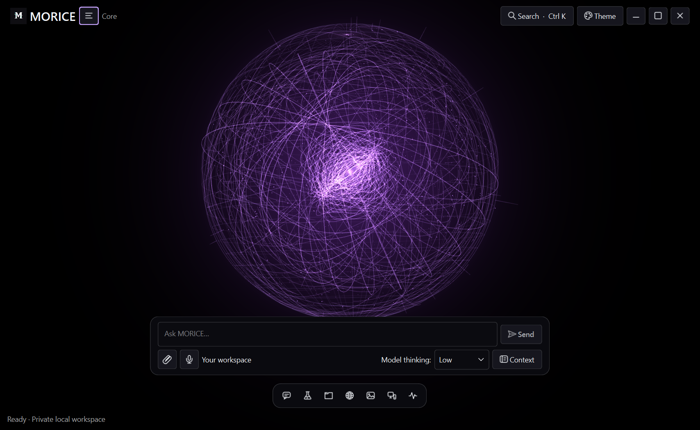

**New: Security → Security Lab.** Inspect an unknown file, distinguish encoding from encryption, estimate password recovery, and test supplied passwords or an authorized recovery key. Results come from bounded local cryptographic operations, complete readback and hashes. The same workspace adds Android diagnostics, source review, scoped HTTP checks and an owned messaging challenge with an actual source repair and before/after regression.

The release keeps MORICE's continuous purple globe, three complete themes, voice mode, natural-language controls, rich responses and existing workspaces. **UNLEASHED is the release name; it does not mean arbitrary encryption can be broken or that untested integrations are certified.**

[Download 0.12.0](https://github.com/EONASH2722/MORICE/releases/tag/v0.12.0) · [Release notes](docs/release-notes-0.12.0.md) · [Security Lab guide](docs/security-lab-guide.md) · [Validation and limits](docs/security-lab-validation-0.12.0.md)

## Security Lab

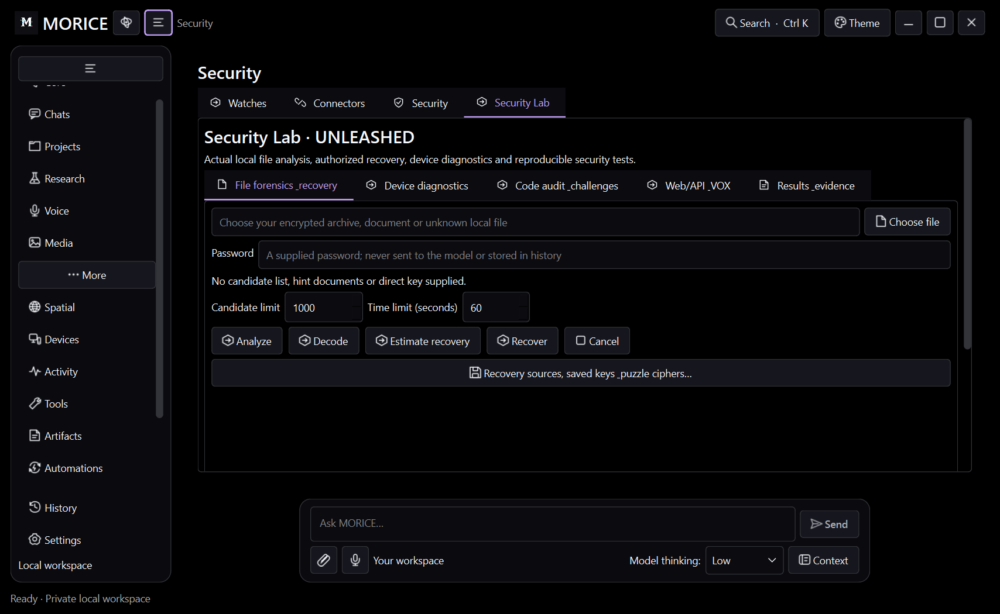

Select a local file and use **Analyze**, **Decode**, **Estimate recovery**, or **Recover**. A password field, explicit candidate list, owner-supplied hint documents, optional conventions and named recovery keys provide the evidence. Secrets stay outside the model, conversation history and saved reports. Recovery keys can be stored explicitly through the Windows DPAPI vault.

| Capability | Implemented scope |
| --- | --- |
| File forensics | Signature, claimed extension, SHA-256, entropy sample, Unicode encoding/script detection and bounded structural checks |
| Reversible decoding | Validated Base64, Base32, hexadecimal, URL/HTML entities and GZIP chains; decoding is labelled separately from decryption |
| ZIP recovery | Supplied candidates against WinZip AES or legacy ZipCrypto, complete member reads, HMAC or CRC checks and output hashes |
| PDF recovery | Password decrypt/rewrite/readback through optional `pypdf`; readability is not AEAD authentication |
| Direct-key recovery | AES-GCM and ChaCha20-Poly1305 for the documented MORICE manifest envelope; requires its actual key or password |
| Source review | File/line/hash findings labelled **POSSIBLE**, plus dependency inventory without invented CVEs |
| Messaging challenge | Owned localhost identities, authenticated send/store/recipient readback, a source patch through the existing Verified Action Runtime and repeated authorization checks |
| Scoped web/API checks | One explicit origin; observed headers and owner-mapped VOX delivery with two authorized test identities |
| Device diagnostics | Official ADB discovery, Android USB/wireless authorization, exact-device read-only diagnostics and Windows Bluetooth metadata |

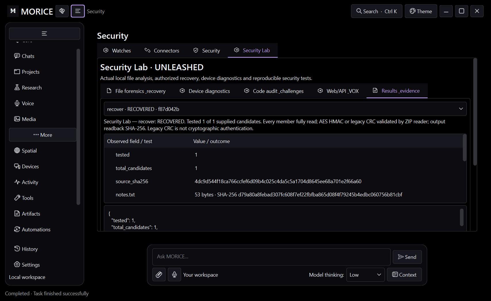

Results show actual attempts, remaining workload, elapsed time, artifacts and export receipts. Cancel interrupts the owned worker. Export uses a new destination and independent hash readback; the original encrypted file is preserved. Failure states include `WRONG_KEY`, `MISSING_KEY`, `CANDIDATES_EXHAUSTED`, `UNSUPPORTED_FORMAT`, `RESOURCE_LIMIT_REACHED`, `CANCELLED` and `INTEGRITY_CHECK_FAILED`.

Try these after selecting the relevant file or source:

- “Analyze this encrypted archive.”
- “Try the recovery hints I provided.”
- “Check whether I have a matching recovery key.”
- “Estimate whether password recovery is feasible.”
- “Cancel recovery.” / “Show what has been tested.”
- “Export the recovered files.”

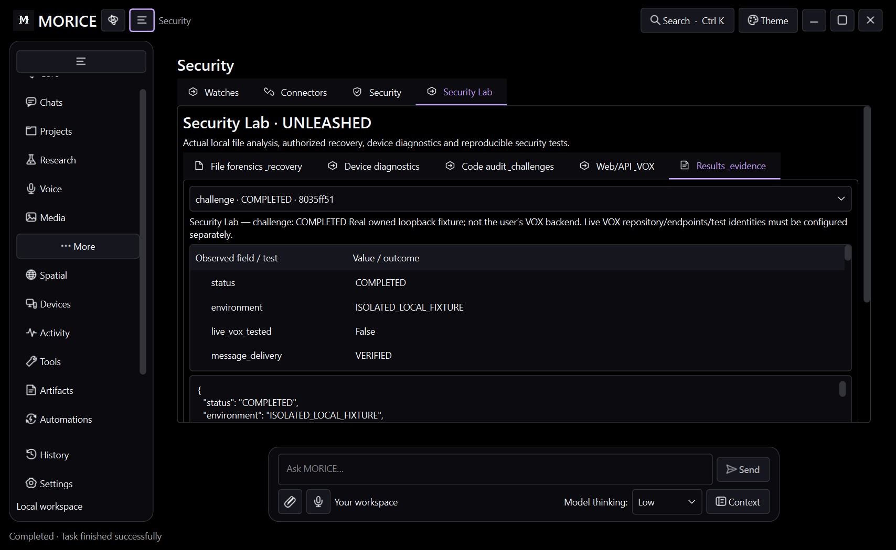

The owned challenge is a reproducible fixture, not a test of a live service. Real VOX delivery requires the actual source repository, exact API mapping and both authorized identities; MORICE does not guess a recipient or silently substitute a fixture. Physical Android/Bluetooth hardware and a live VOX deployment were not certified. ZIP64, 7z/RAR/Office password recovery, arbitrary raw encrypted streams, online password guessing and Bluetooth GATT control are unavailable. Strong random encryption without its secret is reported as impractical to exhaust.

## One interface, three themes

| White | Glass |
| --- | --- |
| 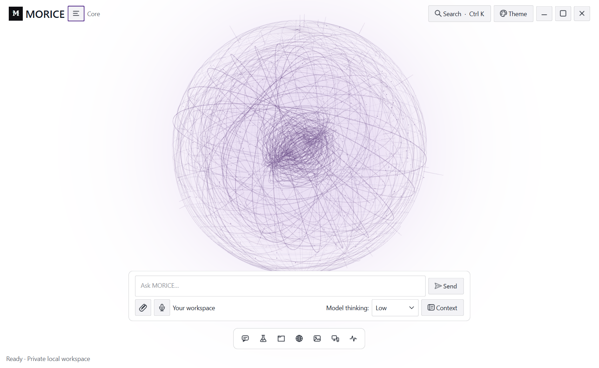 | 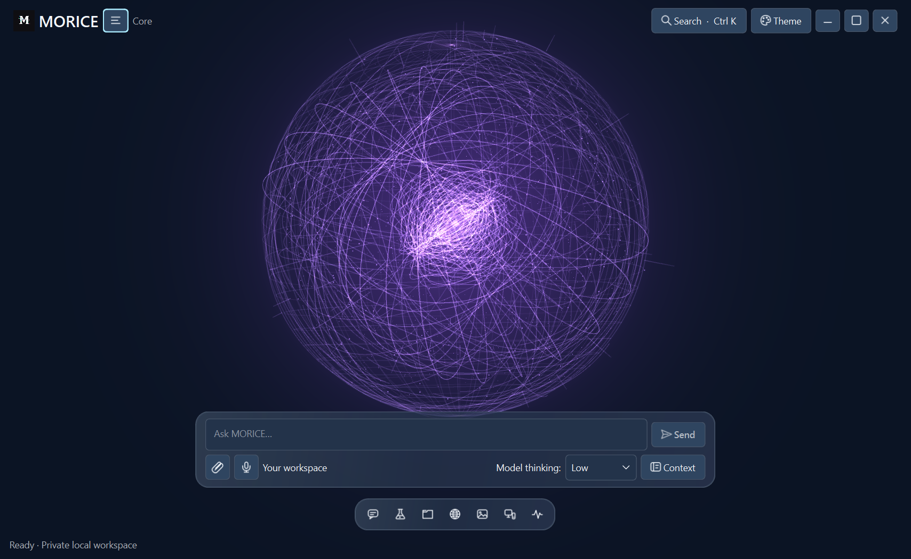 |

**White, Pitch Black and Glass** apply across navigation, settings, dialogs, scientific canvases, rich responses and the globe's atmosphere. Globe Color and Globe Glow Color are independently adjustable. Glass uses translucent panels and native window opacity; it does not capture the desktop.

The GPU globe forms at startup, animates while idle and follows actual work. Drag to rotate with inertia, scroll to zoom, click for a ripple and double-click to reset. Cursor interaction smoothly takes over idle movement and remains available during generation. Reduced Motion and hidden-window throttling remain supported. Wake activation opens chat in the selected theme with existing microphone permissions.

## Chat, reasoning and voice

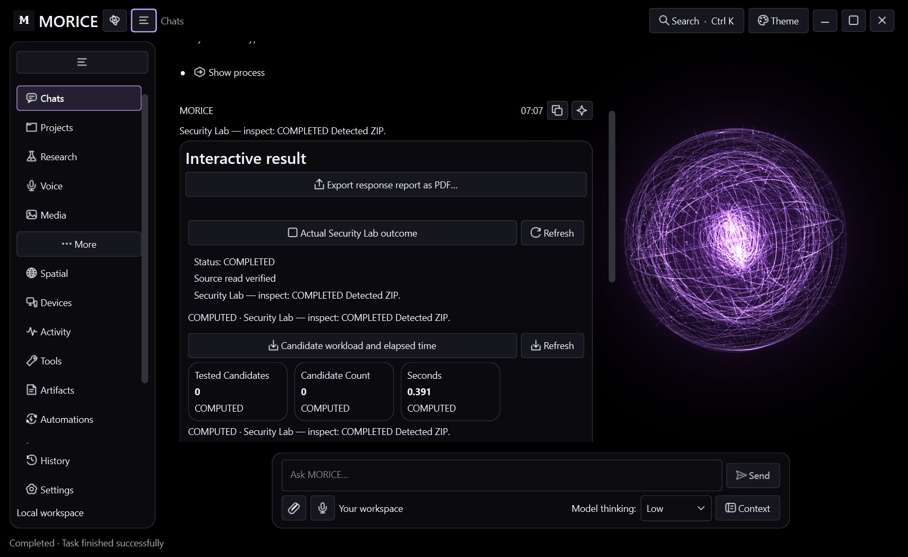

**Model thinking: Low / Medium / High / Extra high** is in the chat composer. Higher levels select the reasoning profile and increase bounded reasoning/output budgets; Low retains automatic fast replies. Expand the activity view for actual context preparation, link reading, model loading, reasoning-token activity and writing. These are execution summaries, not a claim to expose verified internal reasoning.

The preferred installed reasoning model is **`Qwen3.5-4B-abliterated.Q6_K.gguf`**. **Qwen3 4B Instruct 2507 Q4_K_M** remains a separate fast profile. Choose either in **Settings → Models**; explicit selections take precedence. GGUF weights are separate, are not bundled in the release and must fit available RAM/VRAM. A model's name or quantization does not establish answer quality.

Ordinary questions and engineering prompts stay written replies. An explicit visualization request or a relevant saved/tool result can create a rich response. Markdown, tables, code and inline/display LaTeX finish in the same streamed message bubble. Retained chat search, incremental older-message loading and reading-position preservation remain available.

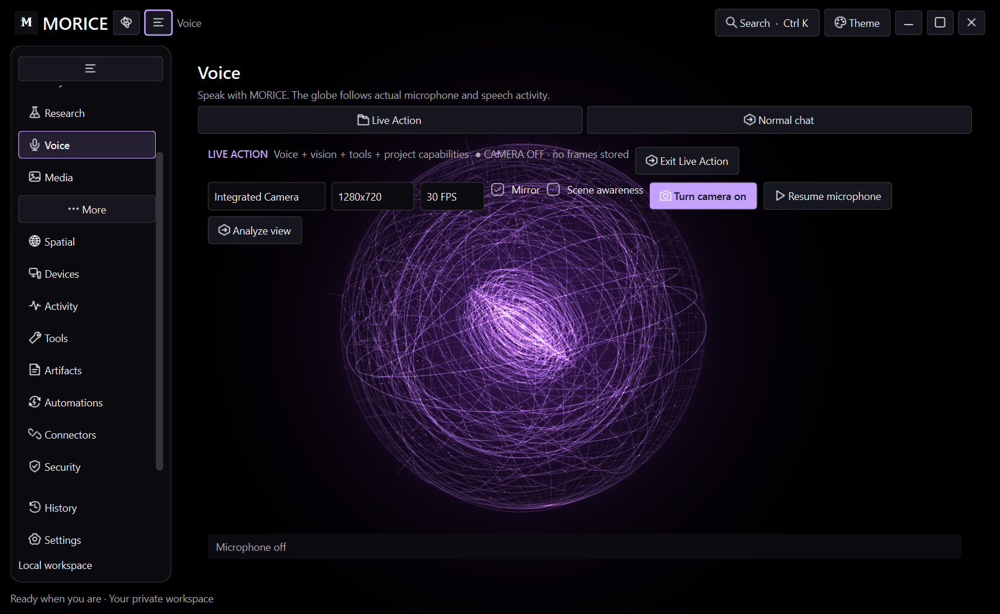

**Voice mode has no text composer or spoken-answer text overlay.** Its globe follows actual speech playback levels with smooth attack and release; microphone and camera controls remain available. Typed chat keeps its editor. Optional background wake, magic words and double-clap activation retain explicit microphone access. Hardware latency depends on the audio provider and device.

## Workspaces and natural-language control

Typed requests and voice transcripts use the existing Capability Kernel, domain owners and Verified Action Runtime. Simple navigation avoids loading a model; less direct requests can use the configured local model to propose typed, validated actions. Missing targets receive a clarification.

| Workspace | Examples and scope |
| --- | --- |
| Projects | “Open my latest project”; prepare/review changes, apply checked files, run discovered tests/builds, retain failure evidence and undo supported changes |
| Research | Saved projects, hashed evidence, bounded unit-aware calculations, actual experiments and existing CAD artifacts |
| Spatial | Supported places, ambiguous-match resolution, WGS84 distances and verified coordinates |
| Media | Generate/edit/vary/animate through installed providers, inspect real artifacts and export verified files |
| Devices | Paired Device Mesh tasks/file transfers; separate Lab diagnostics use official ADB authorization |
| Tools | Notes, tasks, watches, plugins, supported GitHub operations, system information and observed app controls |
| Rich responses | Linked charts/tables, calculators, receipts, job controls, file collections, local previews, STL parts/assemblies and geography |

| Projects | Research |
| --- | --- |
| 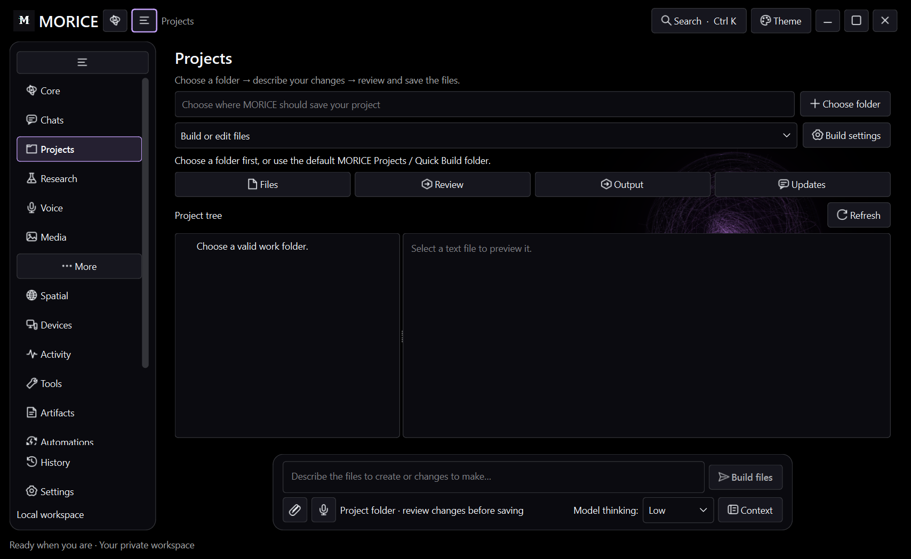 | 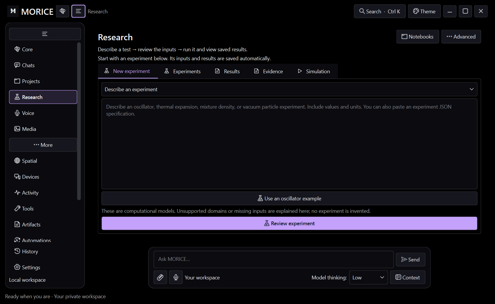 |

| Spatial | Media |
| --- | --- |
| 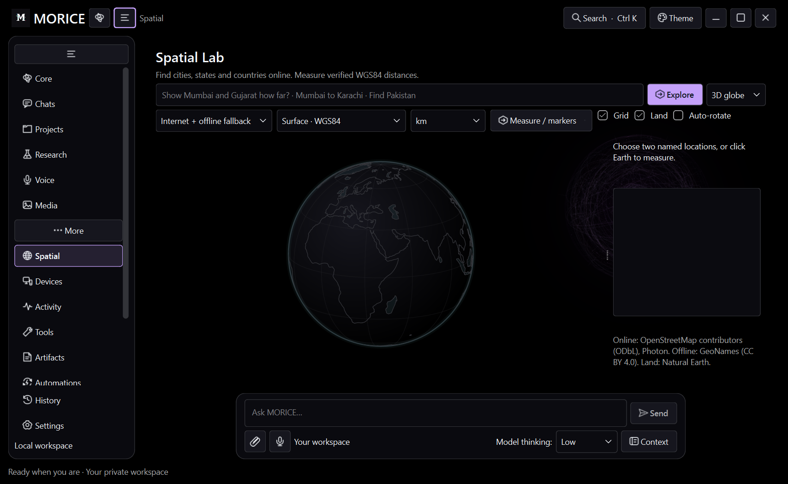 | 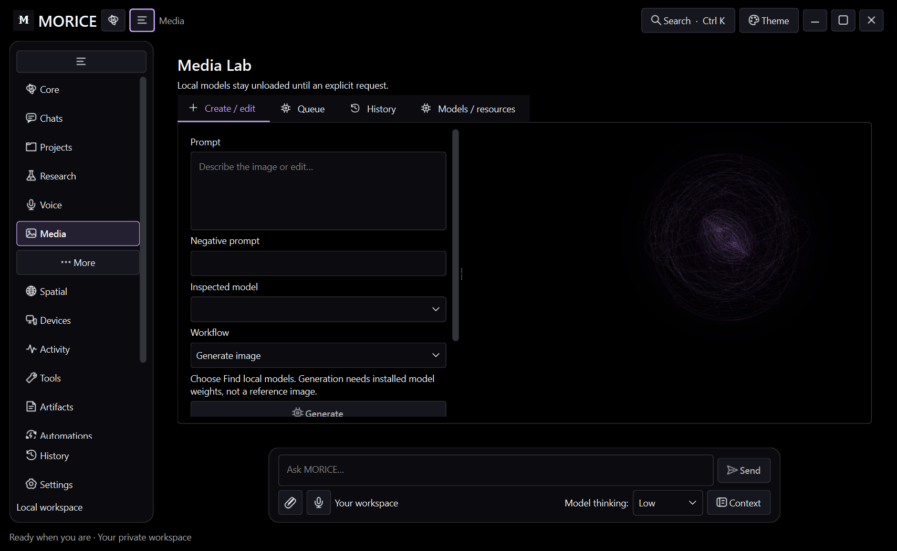 |

**Desktop automation** is an opt-in toggle under **Settings → Permissions & control**, off by default. Enable it for requested third-party Windows app control through supported accessibility interfaces. With it off, MORICE explains where to enable it. Revocation stops access and pending approvals; consequential actions keep their existing confirmations. Protected/custom controls can remain unsupported.

Research results, files and plots are tied to actual inputs and stored evidence. MORICE does not certify scientific correctness, invent measurements or promise a universal CAD/solver backend. See the [feature matrix](docs/feature-matrix.md), [research guide](docs/research-core.md) and [NLUI/rich-response guide](docs/nlui-rich-response-guide.md).

## Installation

Use matching assets from [MORICE 0.12.0 (UNLEASHED)](https://github.com/EONASH2722/MORICE/releases/tag/v0.12.0). Verify downloads with `SHA256SUMS.txt` or `checksums.json`.

- **Windows installer:** download setup and all matching numbered `.bin` slices into one folder, then run setup. Installation is per-user.
- **Portable:** extract `MORICE-Windows-v0.12.0-Portable.zip` and launch `MORICE.exe`. Keep `_internal` beside it.
- **Python:** Python 3.12+ and the model-free wheel below; PDF/research adapters require the research extra.
- **Android:** the [separate 0.8.0 companion APK](https://github.com/EONASH2722/MORICE/releases/tag/v0.8.0-android) supports Android 9+. It is not a new 0.12.0 Android build.

```powershell
python -m pip install ".\morice_ai-0.12.0-py3-none-any.whl[research]"
morice
```

Inference needs compatible local runtimes and installed weights. Media, voice and Android diagnostics need their respective providers/tools. Missing providers leave other workspaces usable. Windows downloads are preview builds; signing status and exact checks are recorded in the release audit.

## Run from source

```powershell
git clone https://github.com/EONASH2722/MORICE.git
cd MORICE
py -3.12 -m venv .venv
.\.venv\Scripts\Activate.ps1
python -m pip install -e ".[dev,research]"
python morice_app_launcher.py
```

Use the isolated test harness to keep writes out of the real user profile:

```powershell
python scripts/run_isolated_tests.py tests -q
cd website
npm ci
npm run build
```

## Documentation and project information

- [Documentation index](docs/README.md), [user manual](docs/user-manual.md), [troubleshooting](docs/troubleshooting.md)
- [Security Lab guide](docs/security-lab-guide.md), [0.12.0 validation](docs/security-lab-validation-0.12.0.md)
- [Globe, themes and voice](docs/globe-interface-0.11.0.md)
- [Models and performance](docs/model-guide.md), [reasoning and equations](docs/reasoning-math-0.10.0.md)
- [Project Mode](docs/project-mode.md), [Android companion](docs/android-companion.md), [desktop companions](docs/desktop-pets.md)
- [Architecture](docs/architecture.md), [developer guide](docs/developer-guide.md), [plugin SDK](docs/plugin-sdk.md)
- [Changelog](CHANGELOG.md), [contributing](CONTRIBUTING.md), [security reporting](SECURITY.md), [MIT license](LICENSE)

All screenshots above are fresh native 0.12.0 captures using owned fixtures. No reference image or generated mockup is presented as a working feature.
