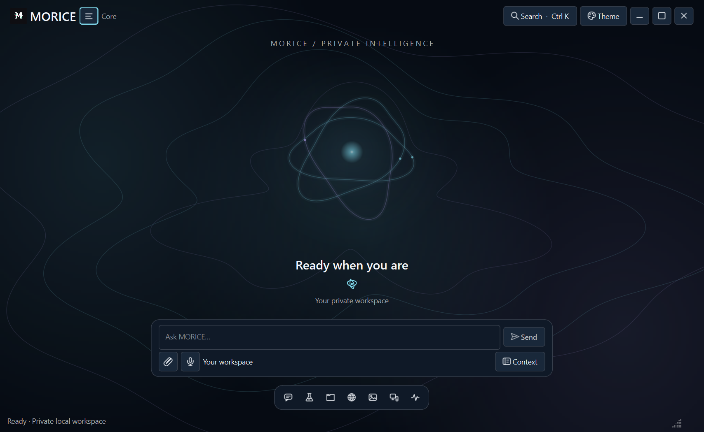
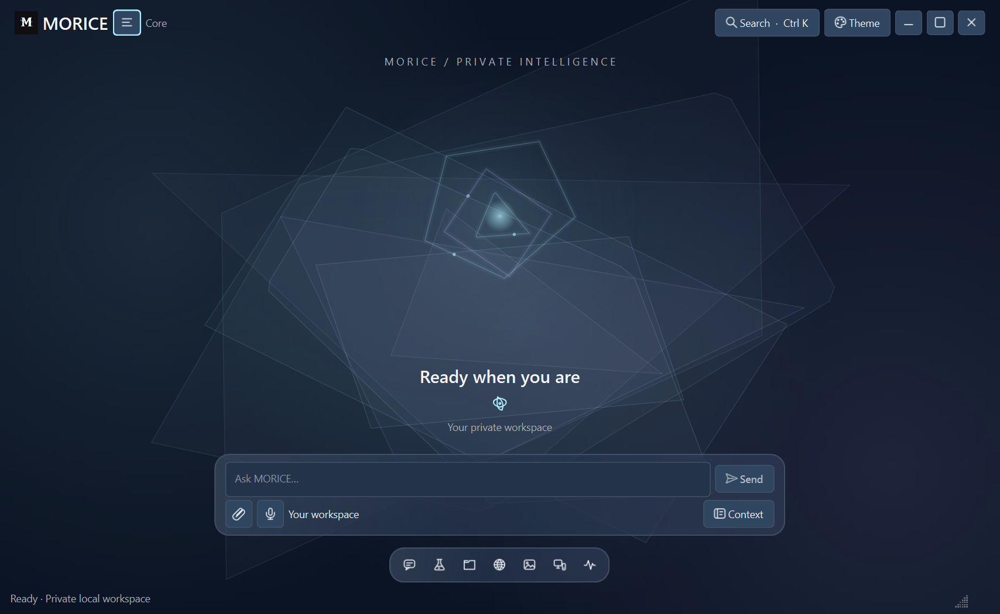
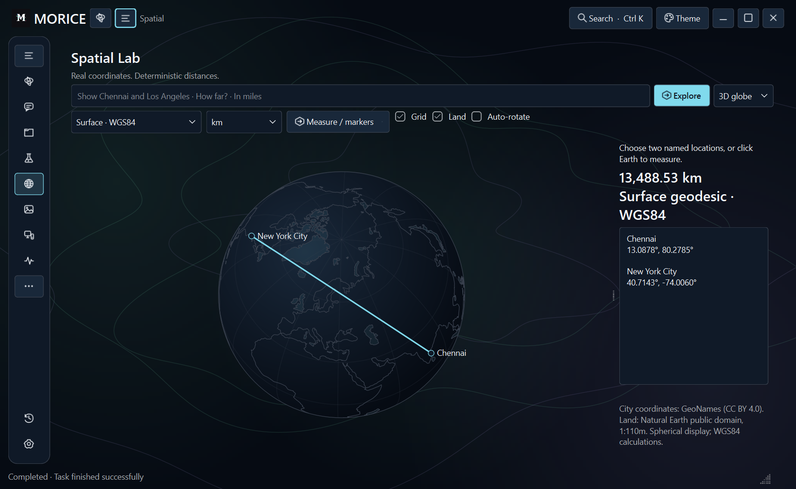
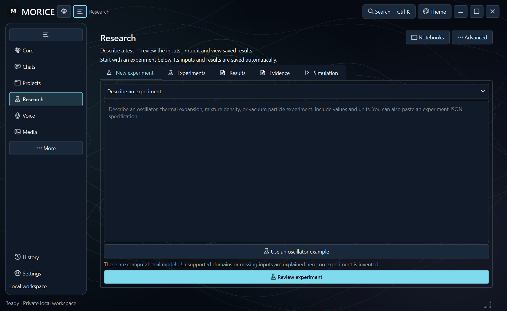
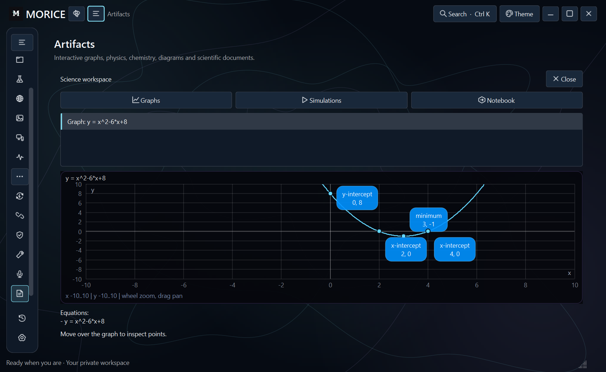
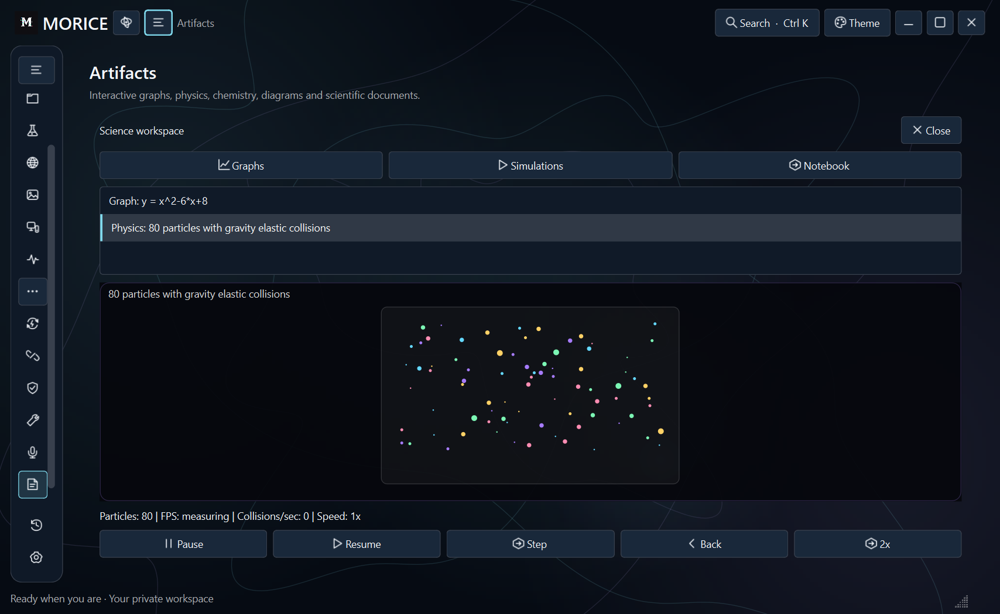
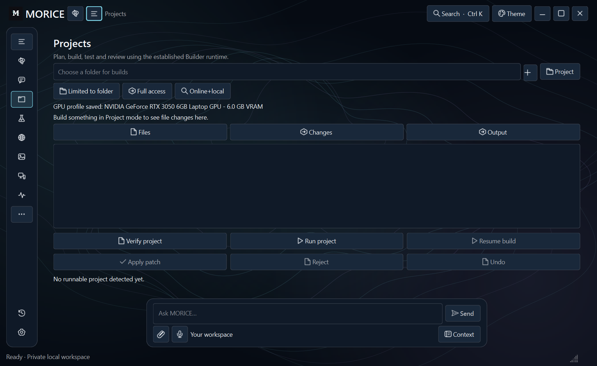
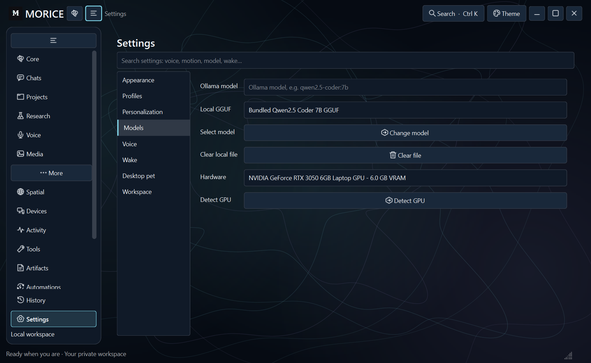
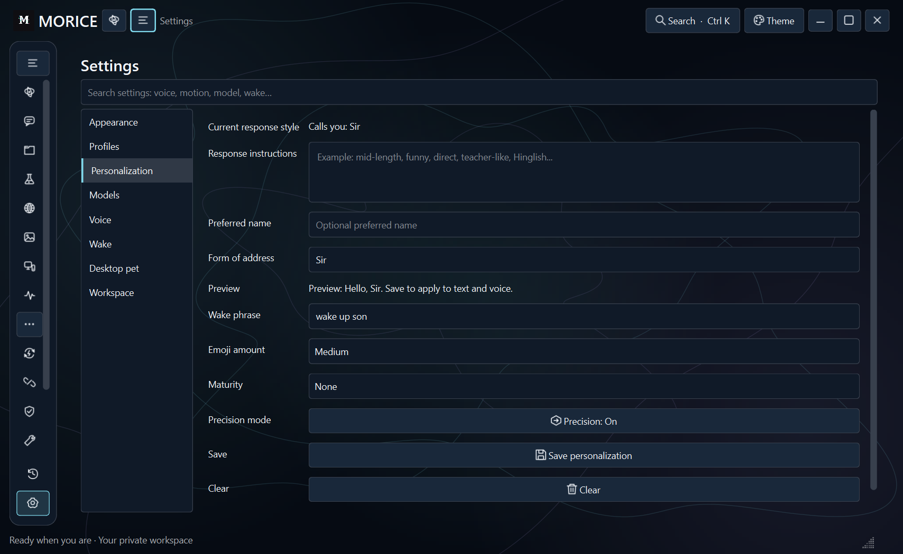

<p align="center">
  <a href="https://eonash2722.github.io/MORICE/" title="Open the MORICE website">
    
  </a>
</p>

<p align="center">
  <a href="https://eonash2722.github.io/MORICE/"><strong>Website</strong></a> ·
  <a href="docs/README.md">Documentation</a> ·
  <a href="https://github.com/EONASH2722/MORICE/releases/latest">Releases</a>
</p>

<p align="center">
  <a href="https://github.com/EONASH2722/MORICE/releases/latest"></a>
  
  
  
  
  <a href="LICENSE"></a>
</p>

<h1 align="center">MORICE</h1>

<p align="center">
  <strong>A local-first Windows AI workspace for conversation, Live Action, real visualizations, project building, and desktop assistance.</strong>
</p>

## Current source: 0.10.0

**0.10.0 reply-routing amendment:** engineering analysis stays a written answer, with normal tables and equations. Pasted parameter tables do not automatically create interactive panels; explicitly request a plot to explore supplied data. Device commands use whole device references, so “tabletop” cannot trigger “tablet”. Engineering challenge headings also keep incidental physics terms out of simulation renderers. Existing saved-result charts and interactive controls remain available.

The [natural-language and rich-response update](docs/release-notes-0.10.0.md) connects chat and voice transcripts to the existing workspaces and verified tools. Try “Open my latest project”, “Run the project tests, then fix this project”, “Compare my latest two experiments”, “Show my latest CAD model”, or “Find the chat about the UI”. Simple navigation uses no language model. Less direct commands use the configured local model to propose typed actions, which MORICE validates before execution.

Actual results can now appear as linked charts and tables, unit-aware calculators, check receipts, job controls, file collections, local previews, real STL parts and exploded assemblies. Display settings and source references survive retained-chat reopening. Short answers keep their ordinary text path. See the [usage guide and measured coverage](docs/nlui-rich-response-guide.md); missing providers, protected app controls and STEP import are explicitly unavailable.

**Reasoning model and equations:** an installed `Qwen3.5-4B-abliterated.Q6_K.gguf` is now preferred for the reasoning profile. Explicit model choices still win, older models remain available, and Qwen3 4B remains the separate fast profile. Change either selection in Settings → Models. Streamed answers now finish with correctly parsed inline/display LaTeX, Markdown tables and code in the same message bubble. See the [model and rendering notes](docs/reasoning-math-0.10.0.md) for setup, actual checks and limits. Model weights are separate downloads or user-provided files.

The new conversational controls cover these existing workspaces:

- **Projects:** select saved folders, prepare and review real changes, run discovered tests/builds, inspect saved results and use actual failures to guide repairs.
- **Research:** open saved projects, run/pause/cancel experiments, compare results, inspect calculations and show actual CAD artifacts.
- **Media and files:** generate with installed providers, edit/vary/animate actual sources, inspect history and previews, and export verified artifacts to a chosen destination.
- **Connected tools:** manage watches and installed plugins, transfer checked files through Device Mesh, and use scoped GitHub and security operations with their existing permissions.
- **Chat and presentation:** find retained conversations, resolve saved targets and ambiguous dates, change supported settings/themes/layout controls, and reopen saved interactive responses.
- **Rich results:** explore 18 native component kinds, linked charts/tables, unit-aware calculators, actual progress, file previews, STL parts/assemblies and geography; export actual chart images, data samples and PDF reports.

Desktop control is explicitly opt-in, actions retain their existing confirmations, and unavailable providers or unsupported controls report their actual limits. Rich sections load near the viewport and release hidden work; delayed source results preserve the reading position.

**Desktop automation permission:** the integration update adds **Settings → Permissions & control → Desktop automation**, off by default. Enable it to let MORICE operate requested third-party app windows and supported Windows accessibility controls. When it is off, MORICE explains where to enable it and asks you to resend the request. Turning it off revokes access and pending approvals; enabling it preserves existing confirmations for consequential actions. MORICE's own workspace navigation and tools do not require PC control. Custom/protected controls without a supported accessibility interface remain unavailable.

The earlier [0.9.5 fast replies and memory update](docs/release-notes-0.9.5.md) added automatic fast/thinking model routing, a separate **Fast Reply Model** setting, indexed recall across the entire retained current chat, and optional approved personal preferences. Chat scrolling loads earlier messages without losing the reading position or snapping to each streamed token. See the [setup and privacy guide](docs/fast-memory-guide.md) and [implementation and validation report](docs/fast-memory-report-0.9.5.md).

The existing 0.9.5 downloads are amended with a fix for duplicate assistant bubbles during history scrolling and returning to the latest reply. Informal date questions now use the system clock.

The same publication also repairs long technical analysis: incidental science terms no longer open an empty Research project or a visual renderer, the installed thinking model remains available without a custom selection, and detailed prompts retain their full text and answer budget. A unit-aware electromagnetic harvester model supplies checked conditional calculations for complete labelled parameter tables. See the [technical reply amendment](docs/technical-replies-0.9.5.md) for its assumptions and limits.

The [0.9.4 location and image update](docs/release-notes-0.9.4.md) adds online city/state/country lookup, understands distance questions, and makes prompt-only image generation explicit. See [the new guide](docs/spatial-media-0.9.4.md).

The [0.9.3 workspace update](docs/release-notes-0.9.3.md) makes Project navigation select the file-building workflow, keeps project updates and browser previews together, and adds a guided experiment form. See the [Projects and Experiments guide](docs/simple-workspaces.md) for creating files, reviewing changes, and running real computations.

The renovated desktop uses a luminous Core, a visible message composer, authored vector icons and twelve distinct visual themes. Shapes turn, breathe, float and unfurl in continuous loops; particles follow closed paths without jumping between screen edges. LOW quality keeps inexpensive ambient motion, while Reduced Motion and hidden/minimized windows pause decoration. The original logo is unchanged and the Core contains no eyes or face.

Current source extends the existing Capability Kernel, parallel agents, verified actions, Builder, Research, Device Mesh, Ambient/Security and Media systems. It adds online place lookup with offline fallback and deterministic WGS84 Spatial tools while keeping shared permission, verification and resource-lease ownership.



Choose **Theme** in the top bar to preview a theme or toggle **Animate the workspace**. **Glass** adds translucent application panels, soft procedural refraction and reflective edges. Fine contours use native antialiased vectors over cached diffuse light; the field never captures desktop pixels. Core shows a bottom launcher, and workspaces show a left sidebar, so navigation appears once.

| Theme | Shape and motion |
| --- | --- |
| MORICE | Flowing plasma ribbons and precessing orbits. |
| Glass | Floating crystal facets and refracted light. |
| Obsidian | Turning basalt polygon rings. |
| Ice | Six-fold frost crystals that bloom and turn. |
| Amethyst | Breathing layered petal rosettes. |
| Midnight | Drifting constellations and an orbital star atlas. |
| Neon | Angular circuits with travelling lights. |
| Monochrome | A swaying diamond lattice. |
| Custom | A harmonic braid in your chosen palette. |
| Arctic | Dancing aurora curtains. |
| Solar | Rotating corona filaments. |
| Crimson | Soft returning resonance ripples. |



| Workspace | Purpose |
| --- | --- |
| Projects | Plan, build, test and review with existing Builder authority. |
| Research | Inspect provenance, controlled computations and resumable experiments. |
| Spatial | Find cities, states and countries online with offline fallback; compare geodesic/chord distances, bearings and paths. |
| Media | Generate images from prompts with installed models; use optional references for edits and inspect verified outputs. |
| Activity | Inspect real public task/events and cancel owned work. |
| Settings | Search preferences, preview themes/profiles and configure explicit voice/wake access. |



**Validation scope:** [0.9.4 validation](docs/spatial-media-validation-0.9.4.md) covers online places, prompt-only image requests and matching package checks. The [0.9.3 workspace validation](docs/workspace-validation-0.9.3.md) records the earlier Project and Experiment update at its own source fingerprint. The preserved [0.9.2 chat repair](docs/chat-routing-validation-0.9.2.md), [0.9.1 UI follow-up](docs/followup-audit-0.9.1.md) and [original release audit](docs/release-audit-report.md) record earlier checks. Physical audio/devices, heavy inference memory and compositor frame pacing remain scoped; compatible providers and sufficient RAM/VRAM are required.

**Downloads:** [Windows 0.10.0 and matching packages](https://github.com/EONASH2722/MORICE/releases/tag/v0.10.0) include natural-language workspace controls, interactive results, the desktop permission toggle, and the earlier model, memory and scrolling repairs. Large model weights are installed separately. [Windows 0.8.0](https://github.com/EONASH2722/MORICE/releases/tag/v0.8.0-portable) and [Android 0.8.0](https://github.com/EONASH2722/MORICE/releases/tag/v0.8.0-android) remain earlier releases. [Latest release](https://github.com/EONASH2722/MORICE/releases/latest).

### Installation

```powershell
python -m venv .venv
.\.venv\Scripts\python.exe -m pip install -e ".[dev,research]"
.\.venv\Scripts\python.exe morice_app_launcher.py
```

Use Python 3.12+ for the desktop. Local media model dependencies may require a separate compatible runtime; the main app remains usable when those providers are unavailable. See [troubleshooting](docs/troubleshooting.md), [architecture](docs/architecture.md) and [the renovation report](docs/renovation-report.md).

The [0.10.0 desktop release](https://github.com/EONASH2722/MORICE/releases/tag/v0.10.0) contains the updated Windows app and matching Python packages. Install `morice_ai-0.10.0-py3-none-any.whl` for the Python package. Provider and physical-hardware limits are documented in the release notes.


MORICE combines local model inference with a desktop workspace that can answer questions, build projects, operate permission-aware tools, and mount validated interactive artifacts directly in chat. Language models provide reasoning and structured proposals; MORICE validates and executes the result through its own renderers, project engine, and desktop services.



**Current-source previews:** the scientific research core, named chat history,
and desktop companions described below are not guaranteed to be present in older
release downloads. See the [research audit](docs/research-core-audit.md) for what
was tested and what remains unimplemented.

## Highlights

- **Local model support:** use a GGUF model through the bundled llama runtime or connect to a local Ollama model.
- **Conversation memory:** contextual follow-ups can reference earlier messages, saved preferences, selected notes, and the active workspace.
- **Real visualizations:** interactive graphs, simulations, molecules, biology models, data structures, charts, diagrams, schematics, and file previews render inside Normal Chat and Live Action.
- **Project Mode:** turn a prompt into validated files and diffs inside a chosen work folder; folder-limited mode stages review while Full access applies routine project writes atomically.
- **General project workflows:** detect Unity, Unreal, Roblox, Godot, Visual Studio/.NET, Android, Node, Python, Java, Rust, Go, and web markers; run available declared builds/tests and retain exact evidence.
- **Desktop assistance:** permission-aware file search, system information, clipboard actions, media controls, workspace tools, tasks, notes, and diagnostics.
- **Live Action:** a separate camera-centered voice workspace that retains Chat, Lab, Tools, graphs, attachments, desktop control, and Project builds; camera access is explicit and exiting stops camera, STT, TTS, and visual work.
- **Automatic context:** relevant local notes are selected without special commands; freshness-sensitive questions use source-linked web context when online and fall back locally when offline.
- **Local background wake (opt-in):** when explicitly enabled, the listener recognizes MORICE, configured magic words, or a double-clap, releases the microphone while Live Action owns it, and opens without stealing foreground focus.
- **Adaptive execution:** goal state, capability discovery, device context, network/Bluetooth observation, and platform adapters keep execution grounded in verified host abilities.
- **Model manager:** inspect detected GPU/VRAM, compare run plans, validate GGUF files, and switch models without editing configuration files.
- **Extensible platform:** isolated plugins, permission manifests, renderer contributions, lifecycle controls, diagnostics, and package validation.
- **Recovery and updates:** bounded workspace state, backups, verified update staging, rollback protection, activity history, and resumable tasks.
- **Personalization:** optional preferred name and title, live updates for text and spoken replies, wake-line preferences, dark/light themes, custom fonts, emoji amount, response maturity, motion, opacity, contrast, and text sizing. New users receive neutral replies with no assumed name or title.
- **Living desktop launcher:** six animated desktop companions distinguish clicks from DPI-aware drags, react immediately, hide completely over fullscreen apps, and restore or launch exactly one MORICE window without invoking the model pipeline.
- **Android companion:** unified chat, opt-in voice, on-demand Live Vision, and encrypted device-scoped PC/phone tasks without copying desktop Project Mode onto the phone.

## Desktop Companions

Click a pet to restore and focus MORICE, or drag it to interact without opening the app. Iron Man patrols the whole desktop, removes and recalls his Mark 42 armor, and fights rogue drones; Spider-Man pendulum-swings, temporarily meets a symbiote, and webs masked tech raiders. Dog fetch, cat deep-sleep/stretch, horse graze/rear/gallop, and skeleton collapse/scatter/reform scenes use persistent randomized cooldowns. The behavior loop is local and deterministic; it does not load a model, use the network, or wait for an agent.

The characters currently use procedural artwork and still need visual refinement;
movie-accurate Mark 42 detail and fully polished animation are not claimed.
The [desktop-pet guide](docs/desktop-pets.md) explains behavior and settings.

## Scientific Research Core — Preview

Attach research files in ordinary chat to preserve hashed evidence, profile CSV/XLSX
datasets, and maintain a persistent research project. Explicit calculation blocks
support physical units and bounded parameter sweeps. Export actual JSON records,
CSV statistics, sampled SVG plots, Markdown summaries, and original evidence with
checksums. Selected local-model interpretations are labeled **unverified inference**.

The **Chat history** action supports named, searchable, compressed conversations,
reopening their research projects, archive, protection, and per-chat retention.
The default is **Never delete**.

This is not the completed Universal Scientific Research Core: automated literature
retrieval, research-image interpretation, general solver integrations, formal
hypothesis testing, and scientific validation remain unavailable. Read the
[workflow, examples, and limits](docs/research-core.md).

## Interactive Rendering

MORICE never treats prose such as `[a graph appears]` as a successful render. Every completed visual artifact is parsed, typed, rendered, and validated by the host application. Unsupported input receives a visible failure state instead of an imaginary result.

Graph replies explain computed mathematical properties before render status. Bounded
SymPy analysis covers real roots and multiplicities, quadratic vertices and symmetry,
polynomial extrema and end behavior, rational holes and asymptotes, and supported
trigonometric, exponential, and logarithmic transforms. General expressions retain
explicitly approximate, viewport-limited evidence; unknown global properties stay
unknown. Axis labels show ordinary values such as **1,000** and **1,000,000** in decimal
form, reserving scientific notation for extreme magnitudes.

<table>
  <tr>
    <td width="50%"></td>
    <td width="50%"></td>
  </tr>
  <tr>
    <td align="center"><strong>Graphs</strong><br>Pan, zoom, inspect, reset, and export</td>
    <td align="center"><strong>Simulations</strong><br>Playback, time controls, replay, and state export</td>
  </tr>
</table>

### Available renderer families

| Family | Current scope |
| --- | --- |
| Mathematics | Cartesian, piecewise, polar, parametric and implicit graphs, linked 2D/3D surfaces, and Mandelbrot views |
| Physics | Particles, projectile motion, pendulums, springs, waves, circular/orbital motion, and Lorenz attractors |
| Chemistry | Supported molecular structures and VSEPR geometries with shared 2D/3D atom and bond state |
| Biology | DNA, neuron, and cell models with labels and switchable 2D/3D views |
| Computer science | BST, AVL, graph, linked list, queue, stack, and hash-table operations with complexity displays |
| Data and diagrams | Bar, line, pie, scatter and histogram charts plus structured flows, timelines, networks, circuits, UML, and domain diagrams |
| Files | Inline previews for local text, source, Markdown, JSON, CSV, images, and PDFs |

The [feature matrix](docs/feature-matrix.md) contains the exact supported inputs and limitations.

## Agent And Tool Runtime

MORICE includes a host-managed agent pipeline rather than sending every request through one undifferentiated prompt.

- Intent routing and ordered multi-task decomposition.
- Context selection, history compression, project indexing, and model health tracking.
- Specialized conversation, coding, research, visualization, and desktop workflows.
- Explicit permission grants for sensitive tools and workspace mutations.
- Patch previews, stale-file protection, transactional apply, and verified undo.
- Background task progress, cancellation, retry, activity history, and recovery.
- Honest completion rules: a tool, render, or project task cannot report success without a validated result.

## Project Mode

Project Mode is a development workspace for generating and editing real files.

1. Open **Projects** and select **Choose folder**. Builder mode is automatic.
2. Keep **Build or edit files** selected, describe the changes, and select **Build files**.
3. Under **Review**, inspect the proposal and select **Save reviewed files**. Discard or undo remain available.
4. Inspect real files under **Files**, verification and errors under **Output**, and responses under **Updates**. Web previews stay in Projects.

Use **Ask about this project** for an explanation. Access and local/online controls are under **Build settings**. See the [Projects and Experiments guide](docs/simple-workspaces.md) for the guided experiment form and concrete remaining limits.

The process panel preserves an expandable observed-action trace after completion. It shows selected
routes, detected tools, files written, commands executed, and verification results, excluding private
model chain-of-thought. MORICE reports file, build, test, editor, and playtest status separately.

## Live Action

Choose **Voice > Live Action**, or use the microphone button beside the composer, to enter and wake the camera-centered workspace; no second wake phrase is required. Live Action uses offline Vosk speech-to-text for user turns and interruptible ElevenLabs streaming speech for MORICE replies. Its live transcript, glass response overlay, and typed composer retain attachments, graphs, Lab, Tools, desktop actions, and project-building. The camera remains off until explicitly enabled, frames stay in memory, and visual inference runs on demand rather than on every preview frame.

Choose **Normal Chat** or **Project**, press the active speaker button again, or use **Exit Live Action** to exit. MORICE immediately stops the camera, cancels microphone capture, reply playback, and vision inference, clears temporary frames/visual memory, and ignores late callbacks. Background wake is now opt-in: explicitly set `MORICE_ENABLE_ALWAYS_ON_WAKE=1` before running the listener. It never activates the camera and yields the microphone to Live Action. The installer no longer enables it by default.



MORICE can work with text-based languages supported by the selected model and installed toolchain. See the [Project Mode guide](docs/project-mode.md) for access boundaries and workflow details.

## Models And Hardware

The model browser detects available GPU memory and presents a practical run plan before a model is selected.

| Dedicated VRAM | Conservative starting guidance; not benchmark results |
| ---: | --- |
| 0-3 GB | CPU-first or small partial offload; use sufficient system RAM |
| 4 GB | Conservative context and partial GPU offload |
| 6 GB | Check the selected model's run plan and available memory before offloading |
| 8 GB | Comfortable offload with additional context headroom |
| 12 GB+ | Headroom for longer contexts or a larger replacement model |

Actual performance depends on quantization, context length, GPU layers, drivers, system RAM, and other workloads. Use **Settings > Models** or **Context > Model** to choose a GGUF or local Ollama model that fits the machine.

The VRAM table is configuration guidance, not a measured RTX 3050 performance claim.
No new model comparison or throughput result is published by this fix. The earlier
local latency tool in `scripts/benchmark_latency.py` labels its character-based
throughput estimate; it must not be presented as a backend token measurement.

<table>
  <tr>
    <td width="50%"></td>
    <td width="50%"></td>
  </tr>
  <tr>
    <td align="center"><strong>Model and Project controls</strong><br>Hardware-aware model selection</td>
    <td align="center"><strong>Settings</strong><br>Appearance, voice, behavior, and accessibility</td>
  </tr>
</table>

## Composer Controls

**Files**, **Voice**, **Model**, **Project**, and **Tools** show text labels when space
allows, with tooltips and accessible names for their icons. Files uses a document
icon; Project uses a folder icon. In compact layouts, **Tools** remains available
and contains the hidden controls, Precision, and personalization settings.

**Personalization: Off** means no custom name, title, style, or wake line is active.
Set an optional preferred name or title in the panel, check the preview, then save.
A title takes precedence over a name; clearing personalization restores neutral
replies. Previously saved titles are preserved, including an intentionally chosen
"All Father".

**Precision: On** uses temperature **0.1** and top-p **0.85**, asks the model to be
exact and avoid guesses, and persists across restarts. Its tooltip explains that
this reduces sampling randomness; it does not guarantee correctness or run a
separate verification pass. Deterministic graph calculations run independently
of this switch. See the [reviewer-fix guide](docs/reviewer-fixes.md) for coverage
and limits.

## Install

Download the newest verified build from [GitHub Releases](https://github.com/EONASH2722/MORICE/releases/latest).

### Windows installer

Download the setup executable and every adjacent numbered `.bin` slice into one folder, then run the setup executable. Installation is per-user and includes a Start menu shortcut with an optional desktop shortcut.

### Portable build

Download all portable `.part*` files, the `.parts.json` manifest, and the matching reassembly script from the [MORICE Portable Plug-and-Play Release](https://github.com/EONASH2722/MORICE/releases/tag/v0.8.0-portable) into one folder. Run the script from PowerShell, extract the verified ZIP, and launch `MORICE.exe` without separating it from `_internal`.

### Android companion

Download the signed APK from the [MORICE Android Release](https://github.com/EONASH2722/MORICE/releases/tag/v0.8.0-android), verify its SHA-256 manifest, install it on Android 9 or newer, then pair it through **Panel > Pair a device** on MORICE Desktop. See the [Android companion guide](docs/android-companion.md).

### Python package

Advanced users can install the model-free wheel included with the release:

```powershell
python -m pip install .\morice_ai-0.9.4-py3-none-any.whl
morice
```

Select a local GGUF or Ollama model after launch. Verify every downloaded asset with `SHA256SUMS.txt` or `checksums.json`.

## Run From Source

```powershell
git clone https://github.com/EONASH2722/MORICE.git
cd MORICE
py -3.12 -m venv .venv
.\.venv\Scripts\Activate.ps1
python -m pip install -e ".[research]"
python morice_app_launcher.py
```

## Verify

```powershell
python -m pip install -e ".[dev,research]"
python -m pytest tests -q
cd vnext
pnpm test
pnpm run typecheck
```

Build all release assets with:

```powershell
powershell -ExecutionPolicy Bypass -File scripts\build-release.ps1
```

The release pipeline produces the Windows installer, portable package, source and documentation archives, Python wheel and source distribution, package-content audit, and SHA-256 manifests.

## Documentation

- [User manual](docs/user-manual.md)
- [Feature matrix](docs/feature-matrix.md)
- [Project Mode](docs/project-mode.md)
- [Android companion](docs/android-companion.md)
- [Desktop pets](docs/desktop-pets.md)
- [VNext rendering](docs/vnext-science-workspace.md)
- [Models and performance](docs/model-guide.md)
- [Advanced configuration](docs/advanced-configuration.md)
- [Architecture](docs/architecture.md)
- [Plugin SDK](docs/plugin-sdk.md)
- [Developer guide](docs/developer-guide.md)
- [Troubleshooting](docs/troubleshooting.md)

## Contributing And Security

Read [CONTRIBUTING.md](CONTRIBUTING.md) before opening a pull request. Report security problems privately through the process in [SECURITY.md](SECURITY.md).

MORICE keeps folder boundaries, protected paths, renderer validation, plugin isolation, and sensitive-action confirmations active even when broader Project Mode access is selected.

## License

MORICE is released under the [MIT License](LICENSE).
