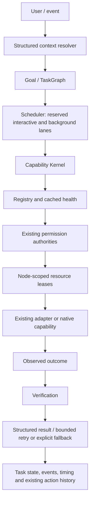

# MORICE Capability Kernel

Phase 1 adds a shared execution boundary to the existing desktop application. `RuntimeServices.kernel` owns the registry, task scheduler, context resolver, authorization facade, resource leases, event bus and timing collector. Existing tool and PC entry points remain callable and return their original result types.



## Register a capability

A capability is a named, model-independent operation with typed execution and verification contracts. Descriptors carry stable ID, name, description, version, provider, category, input/output schemas, permissions, risk, platform/resource requirements, background/streaming/cancellation/verification/retry support, cost/latency estimates, capability dependencies, node ID, timeout and availability.

```python
from morice.kernel import (
    CapabilityDescriptor, CapabilityKernel, ExecutionResult, TaskStatus,
    VerificationResult, VerificationStatus,
)

def add(inputs, context):
    context.cancellation_token.raise_if_cancelled()
    return ExecutionResult(TaskStatus.SUCCEEDED, True,
                           output=inputs["a"] + inputs["b"])

def check(result, expected, context):
    valid = expected is None or result.output == expected
    return VerificationResult(
        VerificationStatus.VERIFIED if valid else VerificationStatus.FAILED,
        ("Numeric result compared with the supplied expected outcome.",),
    )

kernel = CapabilityKernel()
kernel.registry.register(
    CapabilityDescriptor(
        "example.add", "Add numbers",
        input_schema={"type": "object", "required": ["a", "b"],
                      "properties": {"a": {"type": "number"},
                                     "b": {"type": "number"}}},
        output_schema={"type": "number"}, supports_verification=True,
    ), add, verifier=check,
)
result = kernel.dispatch("example.add", {"a": 2, "b": 3})
assert result.success and result.output == 5
kernel.shutdown()
```

Raw dictionaries, `None`, and absence of an exception do not satisfy the execution contract. `kernel.echo` is the deterministic fixture. Domain adapters explicitly normalize legacy results rather than weakening the kernel contract.

The shared schema validator was extracted from `agent_tools.ToolRegistry`, preserving its supported JSON-schema subset: types, required/properties, additionalProperties, array/string bounds, patterns, enum and finite numbers. It is not a full JSON Schema implementation.

## Registry and availability

`register`, `unregister`, `lookup`, `search`, `set_status` and `health(refresh=True)` form the registration API. Discovery filters metadata text, category, provider, platform, permissions, resources, availability and health without probing providers. Health starts `REGISTERED`; lightweight lazy checks produce `AVAILABLE`, `DEGRADED` or `UNAVAILABLE`, are cached for 30 seconds, and can be refreshed explicitly. `DISABLED` stays disabled even during refresh. Expensive dependency initialization belongs in execution or a separate background probe.

Capability dependencies are IDs of other registered capabilities. Adapter health checks separately inspect the existing tool's executable dependencies. Provider registration is independent of model routing. New providers do not require editing kernel execution code.

## Task graph and state

`TaskNode` includes identity, parent, goal, description, capability requirement, inputs/outputs, dependencies, priority, execution mode, constraints, permissions, resource claims, timestamps, timeout, retry/verification policy, optionality, attempt count and final result.

```python
from morice.kernel import TaskGraph, TaskNode, DependencyPolicy

a = TaskNode("kernel.echo", {"value": "research"}, task_id="A")
b = TaskNode("kernel.echo", task_id="B", dependencies=("A",))
c = TaskNode("kernel.echo", task_id="C", dependencies=("A",))
d = TaskNode("kernel.echo", task_id="D", dependencies=("B", "C"))
graph = TaskGraph((a, b, c, d), goal="Example diamond")
outcome = kernel.run_graph(graph)
```

Dependencies use `SUCCESS`, `COMPLETED` (can run after a failed parent) or `FAILURE` (recovery after a failed dependency). Failed mandatory dependencies block their children. A failure condition that is not needed is skipped. `optional=True` permits a failed optional branch to become a workflow warning; `skip_if_unavailable=True` explicitly permits an unavailable optional capability to be skipped. Recovery does not erase the original failed task; graph success remains honest about mandatory failures.

States are `PENDING`, `READY`, `RUNNING`, `WAITING`, `BLOCKED`, `VERIFYING`, `SUCCEEDED`, `FAILED`, `CANCELLED`, `SKIPPED`, `RETRYING`. `ready()` applies dependency conditions. `claim_ready()` atomically selects the highest-priority task and marks it running. `finish()` atomically records its result. The Phase 1 driver executes graph nodes sequentially; independent branches and worker claims are already supported.

`to_json()` / `from_json()` preserve IDs, dependencies, policies, results and safe state. Active/interrupted tasks load as `BLOCKED` requiring review, preventing automatic replay of a possibly completed mutation. Context approval tokens, monotonic deadlines, cancellation tokens, callbacks and legacy objects are not serialized. Checkpoints require JSON-compatible inputs/outputs; incompatible objects raise instead of being silently stringified. Existing action history remains the persistence backend for migrated tool actions; no new database or automatic checkpoint writer is introduced.

## Context and clarification

The resolver shares `RuntimeServices.unified_memory`, observing active file/project fields and reusing `WorkingMemory` confidence and ambiguity. It carries request/conversation/project/research IDs, active files/window/device, preferences, permission constraints, task/parent/capability IDs, resource budgets, deadline and cancellation token without copying conversation transcripts.

A task can explicitly resolve references before executing:

```python
task = TaskNode("filesystem.read", constraints={"references": {
    "path": {"reference": "the file we opened", "expected_kinds": ["file"]}
}})
```

Ambiguous or unknown material references return `INVALID_INPUT` with a clarification message before the handler runs. The UI's existing direct-command clarification flow remains intact. Exact targets cannot be selected solely by unrelated entity salience. Device/graph/simulation aliases can be observed by their existing subsystems; no transcript guessing service or new research/device feature is added.

## Permissions, risk and verification

`PermissionManager` is the common authorization boundary. Native capabilities use the existing `PermissionController` and explicit granted/denied/ask states. Risk uses the existing `RiskClass`, extended with `CRITICAL`; high/critical actions require an exact one-use approval. Risk metadata and resource requirements determine whether a provider is admitted to background execution. Domain sandbox/path restrictions remain in the existing adapters rather than a new generic sandbox.

Tool adapters preview an existing argument-bound grant through `PermissionPolicy.check`; the original executor consumes it once immediately before execution. PC adapters preview `PermissionBroker.authorize(..., consume_confirmation=False)`; the original PC registry performs the consuming authorization. This preserves exact grant semantics and existing saved policies. Context permissions are additional requirements, not grants. An adapter-specific authorization hook must continue enforcing every domain-specific restriction; it cannot treat claimed metadata as user approval.

`ExecutionResult` separates status/success, output, observations, artifacts, warnings, structured errors, metrics, evidence, retryability and verification requirements. Errors include invalid input, permission denied, missing dependency, unavailable capability, timeout, cancellation, execution/verification/resource/internal failures. Developer detail is retained in diagnostics and correlated logs; normal errors use short readable messages.

Verification returns `VERIFIED`, `FAILED`, `INCONCLUSIVE` or `NOT_APPLICABLE` with evidence. Failed/inconclusive verification overrides apparent success; required verification cannot pass as not applicable. Patch verification reads approved bytes back from disk; PC verification preserves the existing observed-process/result evidence; graphs use the existing renderer validator; file previews check actual text; calculations check finite output and an expected value when provided. Scientific correctness beyond supplied expected outcomes is not inferred from numeric finiteness.

## Cancellation, timeouts, resources and scheduling

Graph -> task -> attempt -> child work use linked `CancellationToken`s. Long operations poll `raise_if_cancelled()` or interruptible `wait()`. Progress callbacks publish public status events. Terminal execution polls cancellation and deadlines, kills the owned process tree on Windows (including venv launchers), kills the process group on POSIX, captures final output and reaps the process.

Task deadlines cover attempts and retry backoff. Retry policy allows 1..10 attempts, selected error codes, interruptible exponential backoff and explicit alternative capability IDs. A result must be retryable and the descriptor must support retry. Permissions and resource admission apply separately to alternatives. Mutating, non-idempotent adapters are not retried automatically.

General capability workers have bounded admission and daemon execution threads. On timeout/cancellation cooperative work gets a bounded cleanup interval. Uncooperative work is detached with a warning; it retains its leases and admission slot until it actually exits, cannot overwrite the final task result, and cannot stall unrelated inline work. Python threads cannot be forcibly stopped. Untrusted or indefinitely blocking work should use an owned subprocess or a future process-isolated provider.

The synchronous fast path is reserved for existing PC adapters with native bounded operations and atomic patch mutations. Atomic mutations finish their bounded operation before returning a late timeout/cancellation result; they are not detached while still writing. File/index/verification operations otherwise use monitored workers. Future providers should use `inline=False` unless their bounded behavior is established.

`ResourceManager` atomically admits all claims or none. Claims carry resource name, amount, exclusivity and node ID. Runtime supplies local `DISK` and `FOREGROUND_UI`; providers can register CPU, GPU, VRAM, network, microphone or remote-device capacities as appropriate. Exclusive foreground ownership is declared for application opening and screenshots. Claims are aggregate-capacity checked; budgets are enforced. `resource_wait_seconds` permits bounded waiting, otherwise busy/unavailable resources fail immediately. The existing renderer cache and GPU lock keep their domain-specific responsibilities.

`TaskScheduler` reuses `BackgroundTaskManager`'s reserved interactive/background pools in the real app. Standalone kernels create these pools lazily. Interactive graphs can start while background lanes are occupied. Nodes within a graph obey priority; this phase does not implement cross-graph preemption or a global priority heap. Cancelling a queued graph finalizes its pending task states.

## Events, telemetry and Qt

`KernelEvent` includes ID, enum type, UTC epoch timestamp, source, task/project IDs, payload and severity. The bus serializes publishers, queues reentrant delivery, rejects duplicate subscriptions, weakly holds Python bound methods, supports explicit unsubscribe, isolates subscriber errors and bounds event storms. Functions and built-in callbacks are held strongly until unsubscribe/clear. Subscribers must be short and must relay UI work through existing Qt signals; callbacks execute on the publisher's thread.

Timing records are bounded and cover task queued/started, capability selected, queue/resource wait, execution, progress, verification and task completion. Existing profiler names are fixed; logs correlate task/capability/attempt IDs. No prompts or private model reasoning are recorded by kernel telemetry. Runtime snapshots include the bounded task history and registration count; compatibility tool results include `kernelTaskId`, `kernelExecutionId` and `kernelStatus`.

## Migration map and next phases

| Existing subsystem | Phase 1 status | Next migration |
| --- | --- | --- |
| PC applications/system/files/screenshots | Selected actions adapt automatically through existing PC entry point | Add remaining window/media/browser actions with existing grants and observed-state verification |
| File search/preview/write | Search, patch preview/apply and bounded file preview registered | Broader file providers, undo contract, node-scoped disk claims |
| Project Builder | Existing index/verify/patch/terminal and Git read routes adapt automatically | Lower builder plans to TaskGraph; preserve previews, undo and policy |
| Python/science/graphs | Existing guarded evaluator and graph plugin available through adapters | Register simulations and datasets without adding research logic to the kernel |
| Visualization manager | Existing UI scheduler/cache/Qt signals remain intact | Bridge renderer jobs to graph tasks, retaining cache and renderer validation |
| Model/vision/voice | Existing runtime services remain operational | Register provider capabilities with their existing cancellation and GPU/audio resources |
| Research | Existing store/services remain operational | Research planners emit generic graphs; register tools with evidence and expected outcomes |
| Device/node protocol | Existing pairing/network/security remain operational | Providers carry node IDs/resource locations; bridge existing trusted-node grants |
| Plugins/web/external integration | Existing systems remain operational | Register provider metadata/health; do not create new connector services here |
| Goal orchestrator | Existing API remains for compatibility | Lower its specialized plans into kernel graphs; then retire duplicate specialized execution state |

Phase 2 can add a worker pool using `claim_ready`, `run_task`, `finish`, shared cancellation and resource admission. Phase 3 can add observation and richer verifier/recovery providers. Phase 5 can use provider/node/resource IDs without assuming local execution. Phase 6 can register research capabilities through the same API. None requires replacing the contracts introduced here; the actual agent swarm, mesh and research lab remain future work.

Run `python -m pytest tests/test_capability_kernel.py`, the full `tests` suite, and `python scripts/benchmark_capability_kernel.py`. See [audit](capability-kernel-audit.md) and [validation report](capability-kernel-report.md) for the audited state, measurements, limitations and packaging evidence.
