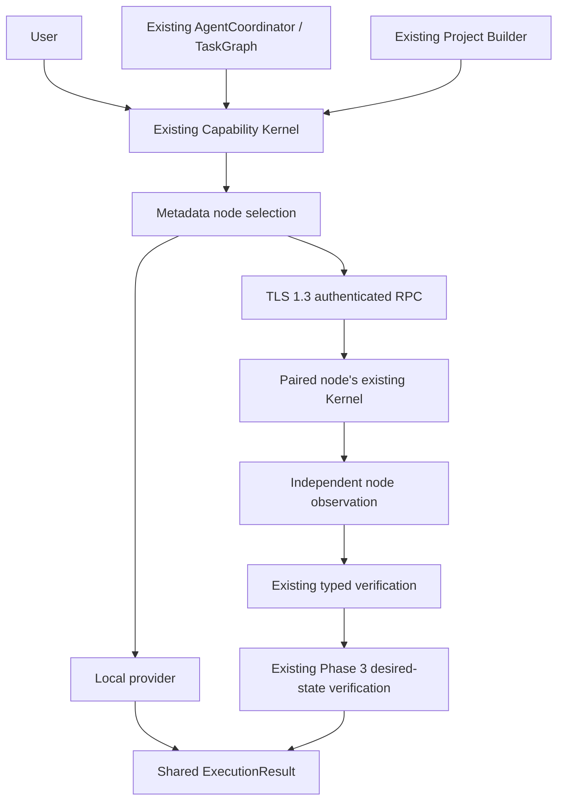

# Device Mesh

Device Mesh makes a paired device a provider in MORICE's existing Capability Kernel. It attaches to the same PermissionManager, ResourceManager, TaskGraph, AgentCoordinator, WorkerManager, SharedTaskState, VerifiedActionRuntime and ActionJournal. Project Builder sends verified artifacts through those providers. There is no remote agent runtime, permission authority, task graph or final history.



## Startup and node model

Networking is off by default. RuntimeServices constructs the mesh lazily when Devices is opened or networking has explicitly been enabled. Local deterministic commands retain their direct path. With no peers, the rest of MORICE continues to work. The Devices checkbox persists `device_mesh_enabled`; the heartbeat reconnects only previously paired identities while enabled.

`NodeRegistry` wraps the existing cryptographic TrustedNodeStore. Stable node IDs derive from the P-256 public key, not a friendly name, IP address, port or transient discovery entry. Names can change; group membership and defaults retain IDs. Provider lookup adds `(node_id, capability_id)` alongside existing local lookup. Runtime metadata includes connection, capabilities, resource capacities, permitted health measurements and latency. Missing GPU, VRAM, battery or capture hardware is omitted rather than invented.

Discovery reuses bounded LAN discovery on UDP 47652. Its announcements are untrusted metadata. Manual addresses work when discovery is filtered. The desktop listens on LAN only after explicit enablement; the standalone node defaults to loopback. Firewalls, network isolation and Android background restrictions can prevent reachability. No cloud relay, router configuration or firewall bypass is implemented.

## Pairing, identity and transport

Open **Devices → Pair this node** on the receiving desktop. The panel displays a six-digit code, pairing port and full certificate fingerprint for a two-minute window. Enter the address, code and fingerprint on the other owned node. Review and confirm the requesting name/identity and limited status/Inbox grants on the receiving desktop; then explicitly finish on the requesting node. Discovery alone never grants trust. Code attempts are bounded, a valid code is consumed once, and expiration or revocation requires another explicit pairing flow.

The pairing connection uses TLS 1.3 and verifies the full receiving certificate fingerprint before transmitting the code. The pairing endpoint accepts only pairing operations. Normal RPC requires mutual certificates, a matching authenticated sender ID, exact certificate pins and an unrevoked trust record. Pairing itself does not permit arbitrary execution: both the stored capability grant and the existing per-node permission policy are checked.

Windows protects the private identity and trust representation with the existing DPAPI SecureVault. The temporary key file required by CPython SSL contains encrypted PKCS8, has a random in-memory password and is removed after loading. Linux stores the private identity under a 0700 runtime directory with a 0600 file. Android uses a non-exportable P-256 Android Keystore key and the existing encrypted SecureNodeStore for peer/intent records. Certificate validity is five years; automatic renewal/rotation is not implemented. Local owners must re-pair when rotating a certificate. The runtime directory is trusted local state, not an OS sandbox against its owner.

Design references: [Python SSL](https://docs.python.org/3/library/ssl.html), [Android TLS](https://developer.android.com/privacy-and-security/security-ssl), [Android Keystore](https://developer.android.com/privacy-and-security/keystore). The implementation uses platform TLS and does not add encryption algorithms.

The protocol is exactly `morice-mesh/2`; incompatible frames are rejected rather than downgraded. Frames have a four-byte network-order length and a 384 KiB maximum. JSON has depth, array, property and string bounds; duplicate fields, invalid UTF-8 and nonfinite values are rejected. Operations are `pair`, `pair_status`, `hello`, `ping`, `submit`, `status`, `observe`, `cancel` and narrowly typed `event`. A future transport must preserve authenticated identity, these bounds and the same capability/result semantics.

The old `morice-node/1` API remains for compatibility with existing tests. Its historical pairing behavior is not the mesh security path. Desktop v1 network auto-start now defaults off; do not set `MORICE_NODE_NETWORK=1` to obtain v2 pairing. Android's legacy listener is restricted to loopback when no mesh peers exist. No automatic downgrade is used.

## Execution, routing and recovery

Use an existing TaskNode with `constraints={"node_id": stable_id}` or `mesh.dispatch(capability, inputs, stable_id, expected=desired_state)`. Native simple actions can use this direct Kernel route. Multi-node workflows and groups use the existing TaskGraph and AgentCoordinator; each branch retains its own typed result and partial failures.

Selection uses connected/trusted providers, capability availability, explicit policy, node-scoped resources, latency, load, battery/thermal constraints for expensive work and data locality. An explicit target stays pinned; fallback requires an explicit constraint. Sensitive-data routing requires an explicit target. Unknown or ambiguous references fail rather than selecting another device. Named defaults such as `phone`, `tablet` and `compute` are explicit settings. Routing performs no network discovery inside workers.

Scheduler admission reserves resources before bounded agent workers run. Node admission also uses the existing ResourceManager reservation before allocating a driver, and returns a bounded busy response when the required resources are occupied. Leases are node scoped. The node's Kernel remains the authority on its actual physical resources when several coordinators compete.

An execution ACK proves admission only. Completion requires the node's existing ExecutionResult/VerificationResult plus a fresh authenticated observation verified by the coordinator's Phase 3 binding. Generic mutations need a nonempty desired-state contract. False success, missing observations and unsupported postconditions remain failed/inconclusive. HTTP/app launch acceptance does not prove the target application is usable.

Commands have stable IDs and peer ownership. Durable mutation intents are written before execution, storing identity/digest/lifecycle metadata without private arguments or file data. Reusing an ID with different input or desired state is rejected. Interrupted durable intents are never automatically replayed. A matching original intent can be independently observed after restart and compared with its desired state; otherwise review is required. Completed read-only and intrinsically range-idempotent file operations are bounded and evictable; mutation replay history fails closed when full. Journal compaction for long-lived high-volume mutation nodes requires future design rather than silent loss of replay protection.

Cancellation propagates the existing CancellationToken and requests remote Kernel cancellation. Logical cancellation does not prove physical cleanup. The coordinator retains leases until a status confirms that work stopped; after an unconfirmed deadline it marks that node's resources unavailable before releasing its accounting lease. A native uncooperative provider can still retain its own physical resource lease. Heartbeats/reconnects run outside the bounded agent pool. RPC deadlines are short; command deadlines, pairing windows, queue expiration and streams use local monotonic time. Persisted partial-file expiry uses local wall time across restarts and can be delayed by a system-clock rollback.

Offline actions are not queued by default. Explicit `queue_safe` permits only status reads for at most 60 seconds and 32 records. `cancel_queued`, disable and revoke remove pending records. Mutations cannot use this queue. Groups do not turn individual offline/permission/verification failures into overall success.

## Files and Project Builder

`file.receive` exposes only the dedicated Inbox. Transfers use peer-owned UUIDs, 128 KiB chunks, persisted partial ranges, explicit resume, chunk readback and final size/SHA-256 verification. Corrupt partials need explicit restart/cancel. Verified bytes are published atomically without overwriting an existing different destination. Partials never count as complete. Four shared transfer leases, 64 records and a five-minute idle expiry bound storage activity. Python nodes accept at most 1 GiB per file; Android accepts at most 64 MiB and a restricted basename. Ordinary filesystem contents and credentials are not shared automatically.

`mesh.send_file` checks the existing local file-read policy for its selected source. `file.send` reads only the remote Inbox with bounded ranges. `receive_file` verifies every range and the final local file. An interrupted pull retains a partial for explicit resume; cancellation tokens continue through the existing Kernel.

`ProjectBuildRuntime.deliver_to_node` requires a successful existing build and rechecks each artifact hash/scope before sending. Optional `project.inspect` checks a bounded Python source archive using real ZIP integrity and AST parsing without extraction. This proves archive/source syntax, not execution, gameplay, UI appearance or installation. `bind_reviewed_builder` can expose one explicitly reviewed existing session on a node that already has the same builder/Kernel and local authority callback. It reuses `resume`, existing test/runtime validation and source/artifact hash checks. Installation, unrestricted shell and generic remote project generation are off by default.

## Android, Windows and Linux

The existing Android companion is extended in place. On Android 10+, enter the desktop mesh address/code/fingerprint, confirm on desktop, then use the phone's explicit allow button. The phone grants real status/battery, private Inbox files, volume getter/setter and foreground web-link intent APIs. A visible connected-device foreground service hosts mutual TLS on 47661. Volume setters verify the actual Android API level. Web-link intents remain inconclusive because the companion cannot independently prove another app's foreground state.

The manifest declares the normal `CHANGE_NETWORK_STATE` permission required by the network connected-device service on Android 14+ and `MODIFY_AUDIO_SETTINGS` for the existing volume setter. These follow the [Android foreground-service prerequisites](https://developer.android.com/develop/background-work/services/fgs/service-types#connected-device) and [audio permission contract](https://developer.android.com/reference/android/Manifest.permission#MODIFY_AUDIO_SETTINGS). Fresh observations downgrade earlier success if the volume has changed or the received file no longer matches its verified hash.

Android has no mesh camera/microphone/MediaProjection/clipboard/location/media-session implementation in this phase. Those capabilities are not advertised. The old LiveVisionActivity is not a v2 capture provider. OEM background termination, certificate/key-manager interoperability and physical permissions still require an owned-device run. Debug and instrumentation APK compilation is recorded separately from device validation.

The headless Python node runs the shared Kernel, deterministic calculator, status, Inbox transfers and archive inspection:

```powershell
.\.venv\Scripts\python.exe -m morice.device_mesh.node --state C:\Owned\MoriceNode --host 127.0.0.1 --pairing-window
```

For an owned LAN/Linux device choose its private runtime directory and an explicit reachable bind address. Python 3.12+ with TLS 1.3, cryptography, NumPy and SymPy are required for this entry point. It does not launch Qt, voice, a model server or an agent pool. Existing wheel metadata still includes desktop dependencies; a separate slim SBC distribution is not implemented. CPU and process identity are real; additional RAM/storage/battery metrics require an installed optional psutil provider. Remote GPU availability is not assumed. Linux/SBC execution was not validated on this Windows host.

## Streams, privacy and extension points

Only a locally registered, genuinely available source factory can advertise a stream. Capture start requires platform permission plus exact existing one-use confirmations at both ends. The shared ResourceManager holds camera/mic/screen and network leases for the source lifetime. Two sources, 0.2–5 samples/second, 1–60 seconds and 128 KiB frames are enforced. Peer ownership, hash validation, permission checks, stop/expiry/disconnect/revoke and metadata-only journaling apply. There is no default camera factory, hidden capture, recording or new AI pipeline. `consume_sample` hands checked bytes to an explicitly supplied existing Vision/Voice consumer.

Permission withdrawal denies further use before cleanup and requests cancellation of owned capture sessions, including completed start commands. Disable/revoke do the same; disable has a two-second total cancellation budget before closing networking. Node expiry checks also stop a source when its OS permission or availability is withdrawn. If the peer is unreachable, immediate remote cleanup cannot be confirmed: a cooperating node stops on the 30-second inactivity bound or the source's at-most-60-second lifetime.

Source adapters must provide bounded native reads/close operations. Python cannot force an arbitrary native provider to cooperate; failed close retains the handle/lease for review while disabling network access. Hardware source correctness and live camera/mic throughput were not validated. Synthetic test sources are explicitly labelled in benchmark evidence.

Future providers register an existing CapabilityDescriptor/handler and a genuinely independent observation function, with schemas, permissions, risks and existing resource claims. Do not expose a capability solely because the device has a relevant physical component. Remote descriptions/events are data, never planner/system instructions; events cannot approve actions or alter permissions.

## Reproducing validation

Run `tests/test_device_mesh.py`, existing foundation/action/project tests, and the full pytest suite. `scripts/benchmark_device_mesh.py` starts a separate real OS node process, pairs via a private local administrative channel and measures actual TLS commands/transfers/restart. `scripts/benchmark_device_mesh_limits.py` measures multi-node graphs, cooperative cancellation, heartbeat overhead and an explicitly synthetic source. `scripts/verify_mesh_startup.py` opens actual services/main-window/Devices with networking disabled. All use owned temporary state and assert no sockets, streams or leases remain.

Build the existing Android debug and instrumentation APKs with the configured JDK/SDK. `MeshInstrumentedTest` requires an owned Android 10+ device; compiling it is not a test pass. This host has no attached physical Android device, no functional emulator acceleration and no Linux/Orange Pi environment. See the report and security audit for exact evidence and remaining constraints.
