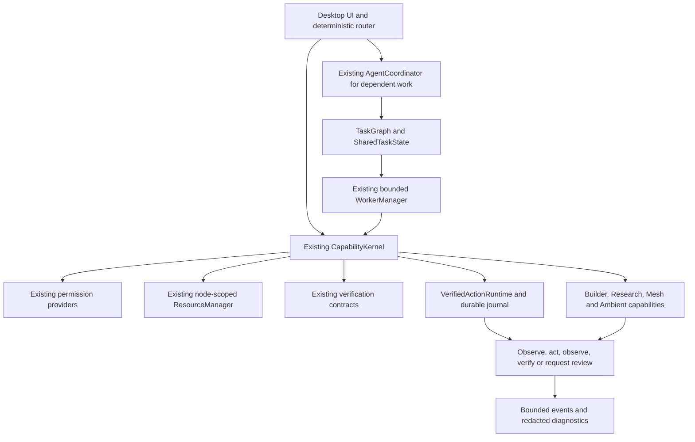

# Phase 8: shared architecture and operations

Phase 8 extends the existing Phases 1–7 runtime. It adds no second kernel, agent pool, permission authority, action executor or mesh protocol. The validation report is [full-stack-hardening-report.md](full-stack-hardening-report.md); the separate source/security review is [full-stack-hardening-audit.md](full-stack-hardening-audit.md).

## Execution and ownership



`RuntimeServices` owns and injects the same kernel, coordinator and actions into Builder, Research, Mesh and Ambient. Normal UI background work uses that runtime's existing background task manager. Optional telemetry reads `peek_runtime_services()` and cannot construct another runtime. Cheap deterministic actions continue to dispatch directly rather than becoming agent workflows. Research sweeps use bounded batches; cold initialization and agent scheduling can cost more than a tiny sequential calculation.

Research, Mesh, Ambient, Builder project services and agent drivers remain lazy at ordinary startup. Health reporting describes dormant components without starting listeners, collectors, providers or models. The report distinguishes installed optional dependencies from initialized native providers. Missing optional packages produce degraded availability rather than a critical failure of unrelated operations.

The static audit inventories 166 modules and one definition of each execution authority. `visualization.ResourceManager` is an existing bounded artifact cache; it has no task admission or physical leases. Function-level imports create deliberate dependency cycles, while the audited top-level import graph has no multi-module cycle. The large Qt window remains a maintenance constraint; Phase 8 extracts health reporting and removes runtime creation side effects without attempting a broad UI rewrite.

## Events and resource admission

EventBus has one ordered FIFO drainer and a bounded pending queue. It releases its bus lock before subscriber callbacks. A concurrent or reentrant publisher enqueues and can return before delivery; consumers must not assume that every concurrent `publish()` call synchronously ran its callback. Queue drops and subscriber failures remain observable. Domain-lock inversion, four concurrent publishers, reentrancy and unsubscribe are covered by behavior tests.

The existing scheduler admits resource reservations before consuming a worker. Direct local chat, prewarm and prefix priming now use the same `agent.reason` model claims when an application runtime exists. Admission fails promptly when busy. A kernel-admitted model call can reuse its actual current **local-node** claim; it cannot borrow a remote node's lease. An independent suspended chat stream cannot leave a context marker that lets another stream borrow its lease. Closing a stream releases its claim. Active model work prevents unloading.

Leases represent actual execution ownership. A timeout or uncertain remote result does not justify releasing a lease while physical work may continue. Unconfirmed remote work retains its lease until transport cleanup. Shutdown reports remaining leases and pending workers and preserves a dirty marker when cleanup is incomplete. Uncooperative native code and Python threads cannot safely be killed; cancellation remains cooperative. OS DNS resolution can exceed a Python network deadline.

Connector retries use existing Ambient due times and exponential poll backoff. HTTP requests have bounded byte, socket and total-response budgets. A network outage marks the provider unavailable and sets a 60-second retry time. Its capability remains degraded but eligible for a later authorized probe. No worker sleeps through that cooldown. Authentication expiry still requires account authorization; rate limits honor their retry time. Disconnect generations prevent late transport replies from restoring an account that was disconnected.

## Durable state and diagnostics

Action intents are persisted before mutation. After an interrupted action, restart observes current state; it never blindly replays the mutation. A corrupt, oversized or unsupported action journal is preserved and blocks mutating actions pending review. Unrelated direct read capabilities remain usable.

Agent snapshots are encoded under the existing state lock, bounded at 64 MiB, flushed and atomically replaced. Builder checkpoint reads use the same maximum input size. Bad checkpoint roots, versions and records admit no work and preserve the original bytes. Research terminal states become visible after the laboratory worker releases its active control, so an immediate resume cannot be lost. SQLite transaction rollback preserves prior evidence; unsupported or corrupt databases must be reviewed rather than overwritten.

Logs, crash diagnostics, action journals and checkpoint diagnostics share credential redaction. Known environment credentials, authorization headers, labeled credential values, URL user information and private-key blocks are removed. Nested records reuse one environment snapshot per operation; the next operation sees newly rotated credentials. Diagnostic strings/items/depth are bounded. Builder source and filename-indexed hashes retain their complete content and key names. Redaction is a diagnostic safeguard, not permission handling or a guarantee that arbitrary unlabeled private prose can be recognized.

Provider bodies, documents, README files, issues and research text remain untrusted data. They cannot issue grants, edit policies or authorize consequences. Existing one-use exact approvals, denial precedence, scope checks and action verification remain authoritative.

## Reproduce the local evidence

Use the existing virtual environment from the repository root:

```powershell
.\.venv\Scripts\python.exe -m pytest -q --disable-warnings
.\.venv\Scripts\python.exe scripts/audit_full_stack.py
.\.venv\Scripts\python.exe scripts/benchmark_full_stack.py --output build/phase8-benchmark.json
.\.venv\Scripts\python.exe scripts/demo_full_stack.py --output build/phase8-acceptance --soak-seconds 120
.\.venv\Scripts\python.exe scripts/benchmark_phase8_model.py --output build/phase8-model.json
```

The demo creates new UUID-named owned directories, loopback HTTP accounts and pinned mutual-TLS nodes. It exercises real calculations, simulations, processes, SQLite, Chromium, files and transfers. Five and ten nodes are full local protocol nodes on this Windows host; they are not physical Android or Linux devices. `--native-interaction` additionally executes the ordinary “Open Calculator” route during a live Builder test. Provider credentials in these fixtures are synthetic.

The model benchmark uses an existing GGUF and existing CUDA llama-server on this host. It reports server token counts and host-wide GPU samples. Do not run it simultaneously with the idle benchmark or interpret host-wide GPU allocation as solely MORICE's. The idle harness settles startup for six seconds, measures three seconds without including expensive observer snapshots in CPU time, and runs three fresh processes. Earlier incorrectly isolated benchmark files are retained but superseded by the corrected measurements.

The acceptance graph is: connector read → independent calculation and simulation → independent verification → stored research and 10k sweep → reproducible export → dashboard build → actual tests → run → Chromium observation and interaction → local TLS artifact transfer and independent hash → completion event → local notification. Separate legs inject a failing test, repair it through Builder, cancel a live process, resume a checkpoint and reject offline/revoked nodes.

## Local packaging

```powershell
.\.venv\Scripts\python.exe -m build --wheel --outdir build/phase8-package
.\.venv\Scripts\python.exe -m PyInstaller MORICE.spec --noconfirm --distpath build/phase8-frozen --workpath build/phase8-pyinstaller
.\.venv\Scripts\python.exe scripts/verify_full_stack_package.py
.\scripts\verify_full_stack_startup.ps1
```

The verifier compares every Python module with the wheel, checks ZIP integrity, imports the wheel with `python -I` outside the workspace and runs verified research on the shared services. It also reads the **actual executable's embedded PYZ** and compares code recursively with current source. The GUI executable intentionally omits `morice.cli` and `morice.__main__`; its launcher includes the normal GUI and the explicit packaging probe.

GGUF files and vision weights are external by default. The existing opt-in `MORICE_BUNDLE_MODELS=1` controls intentional model bundling. Personal settings, journals and environment files must not appear in either archive. The local frozen output uses the existing onedir PyInstaller pipeline; building a signed installer, uploading it, or testing other Windows versions is outside this evidence.

The startup PowerShell harness creates an owned temporary profile outside the checkout, sets `APPDATA`, `LOCALAPPDATA`, `MORICE_RUNTIME_DIR` and `MORICE_LOCAL_DATA_DIR`, removes Python environment variables and restricts PATH to Windows system directories. It runs `MORICE.exe --morice-smoke-test <absolute-output.json>`, creates the actual native Qt window, runs health checks, pumps the UI for three seconds and records shutdown. The receipt includes the full process launch-to-exit duration; the internal probe clock separately excludes loader launch. Missing external GGUF is expected degraded chat availability, while unrelated capabilities remain healthy. Frozen startup remains slower than source startup and is a documented release performance constraint.

## Operations and remaining technical constraints

Review health and the final result card before acting on a completion message. A configured connector is not evidence of live connectivity. A successful process exit is not evidence of a usable UI or complete artifact. Research integrity proves hashes, relationships and recomputation within explicit assumptions; it does not establish scientific validity. The ideal-density example assumes additive volumes and a specified mass fraction, with no reaction, miscibility or safety prediction.

On corrupt journal/checkpoint/database state, preserve the bytes and use an explicitly reviewed restore from a known backup. Do not delete state to make startup appear healthy. On dirty shutdown, observe interrupted effects and inspect retained leases; do not force-release them to suppress the diagnostic. For network failure, wait for the visible retry time or explicitly reconnect where account authorization has expired. Scope denial and revocation are not retryable authorizations.

Structured logs rotate; agent histories, events and caches have bounded retention. Verified research packages, build archives and encrypted quarantine evidence require explicit manual retention/archival decisions. There is no automatic deletion of user files. The recorded two-minute steady-state soak is practical local stress evidence, not hours of uptime, an MTBF estimate or a guarantee of zero future leaks.

Voice tests use controlled PCM providers and sinks and prove streaming order, barge-in, cancellation and request ownership. Physical microphone/wake performance, cloud TTS latency and audible speaker output are not measured. Semantic vision needs an available configured provider; arbitrary-screen understanding is not certified. GitHub production OAuth/relay and physical Android/Linux operation remain unvalidated. Defensive security is opt-in, scoped and heuristic, with no universal malware diagnosis or network-isolation guarantee. Keyboard, focus, DPI and reduced-motion behavior have existing regression coverage; there is no formal accessibility certification.

Phase 9 must extend these same node-scoped resources. The synthetic 4.5 GiB + 3.5 GiB reservations on a 6 GiB pool reject concurrent admission. The actual 4B CUDA model occupied about 5.6 GiB of **host-wide** GPU memory in its sample. Cached weights stay resident after request leases end until owned model unload; future generators must account for residency, live free VRAM and offload RAM before allocation. Existing unload hooks are available and refuse active work. This is integration readiness, not an implemented image/video pipeline or permission to install/download models.
