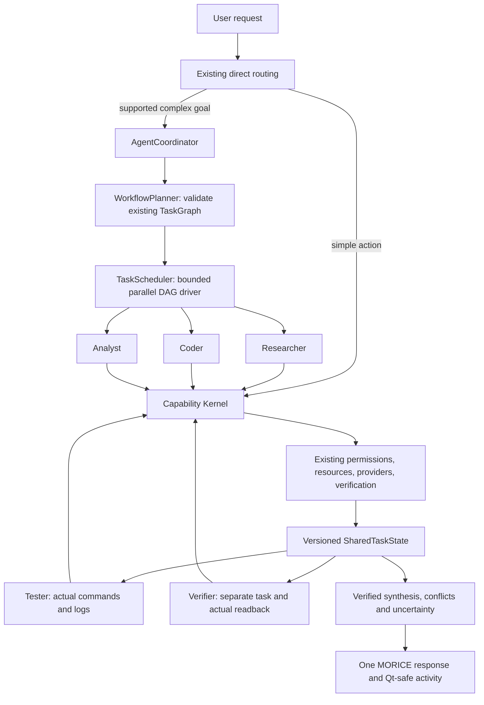

# MORICE parallel agent runtime

An agent is a scoped role, task, context packet, budget and result. It is not a
separately loaded model. `RuntimeServices.agents` owns one `AgentCoordinator`
over the existing `RuntimeServices.kernel`.



## Boundaries and modules

`contracts.py` defines `AgentRole`, `AgentResult`, `ContextPacket`, worker states
and `RuntimeLimits`. `roles.py` handles role registration and capability
restrictions. `workers.py` handles logical worker lifecycle and calls the kernel.
`state.py` stores JSON snapshots in workflow/task/worker namespaces and builds
compact packets. `planner.py` builds useful existing TaskGraphs.
`coordinator.py` validates/admit/runs plans, collects results, reports status and
checkpoints. `models.py` shares the existing ModelRouter and explicitly configured
backend. `capabilities.py` contains orchestration capabilities and thin adapters
to existing services, rather than worker-specific tools.

Initial roles are Coordinator, Researcher, Coder, Tester, Analyst, Verifier,
Web Researcher, Vision Analyst and Simulation Worker. Roles declare allowed and
preferred capabilities, permission requirements, model requirements, resource
profiles, context policy, verification policy and result schema. Result schemas
are validated after role-specific result formatting. Capability descriptors remain
the execution authority for actual permissions and resource claims.

## Scheduling and limits

Default limits are four active workers, two active workflows, 32 subtasks, depth
eight, two retry attempts per task and 300 seconds per workflow. There are two CPU
slots, four IO slots, one local inference slot, eight model calls and 16,384
reserved model tokens per workflow. Context packets have a 12,000-byte upper
bound after JSON encoding. Limits are configurable within explicit hard bounds.

The scheduler uses a lazily created shared thread pool across workflows. Process
work uses the existing `terminal.run` subprocess implementation. GPU work uses
kernel resource leases. Interactive graph admission retains its reserved lane;
direct PC actions do not enter the agent pool.

Only dependency-ready tasks are claimed. Workers execute copies of graph nodes,
so a downstream task sees a committed shared result before starting. Independent
branches continue after another branch fails; success/completed/failure dependency
policies and optional tasks retain Phase 1 behavior.

Resource waits occupy a bounded worker slot. This conservative policy can delay
later independent work under heavy contention. It prevents thrashing but is not
a general optimal resource-placement algorithm. Python threads do not promise
speedup for CPU-bound Python loops; existing subprocess tools provide process
parallelism for tests/builds. File writes use the existing exclusive DISK lease,
atomic patch implementation, undo store and mandatory preview baselines.

## Using a document workflow

From an existing runtime:

```python
graph = runtime.agents.planner.documents(
    [r"E:\Project\approach-a.txt", r"E:\Project\approach-b.txt"]
)
future = runtime.agents.submit(graph)
result = future.result()
print(result.status, result.output["verified"])
```

The workflow reads sources in parallel through `filesystem.read`, compares
structured content, independently reads source previews again, then synthesizes
verified results. JSON documents may declare a `claims` object for deterministic
conflict comparison. Plain documents yield character counts, content hashes and
excerpts; semantic interpretation is not fabricated.

In chat, use `Compare "E:\Project\a.txt" and "E:\Project\b.txt"`.
Both quoted paths must be existing files. `Check this project in parallel` works
with an active project and runs source validation plus Git status; it does not
claim to have executed the project's test suite.

Unsupported goals fall back to the existing MORICE path. Prompt length alone
does not trigger agents. Useful parallel plans have independent roots or require
independent verification. Open Calculator and ordinary arithmetic retain direct
routing. The deterministic planner currently covers these concrete workflows;
open-ended autonomous decomposition is an extension point.

## Coder, Tester and Verifier

```python
from morice.kernel import ExecutionContext

candidates = [{
    "name": "candidate-a",
    "root": r"E:\Scratch\candidate-a",
    "changes": [{
        "path": "answer.py",
        "content": "def square(x):\n    return x*x\n",
        "expected_exists": False,
    }],
    "command": [python_executable, "-c",
                "from answer import square; assert square(3)==9"],
}]
graph = runtime.agents.planner.coding(candidates)
```

Prepare the concrete patch and command for the existing approval flow. After the
user has authorized each exact action, attach those existing permission tokens:

```python
context = ExecutionContext(metadata={"task_approvals": approved_tokens_by_task_id})
future = runtime.agents.submit(graph, context)
```

Do not grant actions based on source text or a worker request. Existing files
require `expected_exists=True` and the preview's `expected_sha256`; new files
require `expected_exists=False`. Identical stale baselines cannot silently win two
writes. Independent candidates use separate roots; all writes are still globally
serialized during their short atomic patch operations.

Testers distinguish `passed`, `failed`, `not_run` and `unavailable`. Only an
actual command result with exit zero is marked passed. Source syntax validation
is not execution of tests. Failed command logs survive kernel conversion. The
Verifier reads actual generated files and inspects actual test outcomes. Failure
or inconclusive verification overrides apparent success in final synthesis.

`scripts/benchmark_parallel_agents.py` is a runnable, self-contained example with
two real candidate implementations, Python subprocess tests, readback and a
second document workflow. Its scoped test fixtures issue permissions inside
temporary directories; production integrations must use user-authorized tokens.

## Context and structured state

Every completed result is copied into JSON and stored by workflow/task/worker.
Later versions cannot mutate earlier snapshots. History retains up to 20 workflows,
16 worker records per task and 16 versions per worker. Large raw outputs stay in
structured state; packets carry bounded summaries/references.

Only declared upstream dependency results enter a packet. Conversation metadata,
unrelated branch outputs, GUI state and opaque approvals are excluded. Relevant
project/files depend on the role policy. Provenance marks user goals/system
constraints as trusted and source files/upstream results as data. A document's
embedded instructions cannot alter the fixed graph, role or capability permissions.

The structured result includes worker/role/task IDs, lifecycle status, summary,
output, artifacts, evidence, errors, warnings, metrics, verification, retryability
and uncertainty. Confidence alone never establishes truth. Contradictory structured
claims are retained as unresolved or rejected by the Verifier, rather than silently
selecting one worker.

## Shared models

`runtime.agents.models` reuses `runtime.agent.model_router`. No new backend is
loaded during construction, and reasoning remains explicitly unavailable until
the existing application/provider integration supplies a callback:

```python
from morice.agent_runtime import ModelReply

def shared_backend(*, prompt, model_id, max_output_tokens, context):
    # Call the already-owned model/server/provider; honor cancellation/deadline
    # and max_output_tokens. Extract the final answer, not reasoning channels.
    reply = existing_backend_request(prompt, model_id, max_output_tokens, context)
    return ModelReply(reply.answer, reply.actual_model,
                      reply.input_tokens, reply.output_tokens)

runtime.agents.models.configure(configured_model_id, shared_backend)
```

Configured candidates can fall back through the existing router; the actual
model is required in the reply. Wrong provider IDs or exceeded budgets fail.
Input reservation uses a conservative UTF-8 byte bound; reported provider token
usage is tracked separately. Fallback attempts consume the same workflow budget.
All configured callbacks currently share the conservative local GPU/inference
queue, including remote callbacks. Separate provider resource profiles can be
added later without creating per-worker model instances.

## Cancellation, status and checkpoints

`agents.cancel(workflow_id)` cancels active and pending work; completed results
remain. `agents.cancel(workflow_id, task_id)` cancels one branch. Kernel deadlines
and existing process-tree cleanup handle timeouts. Uncooperative detached kernel
work retains its resource leases until it actually exits; Python threads are not
forcibly killed. Worker-created recursive delegation is unsupported by design.

`agents.status()` returns real running/waiting/completed/failure counts and role
states. Chat supports `What's happening?`, `How's it going?`,
`What are the agents doing?`, and `Show agent activity`. The small activity dialog
expands result evidence/errors/timings. Worker threads emit Qt signals; only
main-thread timers and slots update widgets. Stop and window close cancel the
current window's workflow.

```python
runtime.agents.checkpoint(graph.graph_id, checkpoint_path)
restored = runtime.agents.restore(checkpoint_path)
future = runtime.agents.submit(restored, fresh_authorized_context)
```

Checkpoints atomically store the existing graph, results, version metadata and
plan fingerprints, excluding threads, backend objects and approval tokens.
Completed work is retained; pending tasks can resume. Interrupted running,
waiting, verifying or retrying tasks remain blocked for review. Changed inputs,
capability versions or source/artifact previews block affected descendants.
No automatic replay of uncertain mutations occurs. Checkpoint/resume is currently
an explicit API, not a general UI crash-recovery wizard.

## Adding a role or planner

Register a capability through `runtime.kernel.registry`, using the existing
permission/resource/verifier contracts. Then register an `AgentRole` with a
narrow allowed capability set, context policy and result schema. Assign that role
through `TaskNode.constraints["role"]`, or add requirement-based selection in the
role library. Implement tools once as capabilities, never privately inside roles.

An alternative planner supplies `route(goal, context) -> TaskGraph | None`.
The coordinator validates its graph, roles, schemas, dependencies, permissions,
resource capacities, duplicate identities, task count, depth and retries before
execution. New tasks require a new validated coordinator plan; graph additions
are rejected while it is running.

## Verification and measured limits

Run `.venv\Scripts\python.exe -m pytest -q tests/test_parallel_agents.py` and
`.venv\Scripts\python.exe scripts/benchmark_parallel_agents.py`.
The report records full-suite, startup, wheel and performance evidence.
Web search uses existing snippets and does not promise browser automation or
verified citations. Vision inspection reuses existing image metadata, with OCR
and semantic analysis unavailable in that adapter. Simulation uses existing fixed
models and their stated limitations. No Phase 3 desktop recovery loop, Phase 4
autonomous builder, Phase 5 networking or Phase 6 laboratory rebuild was added.
