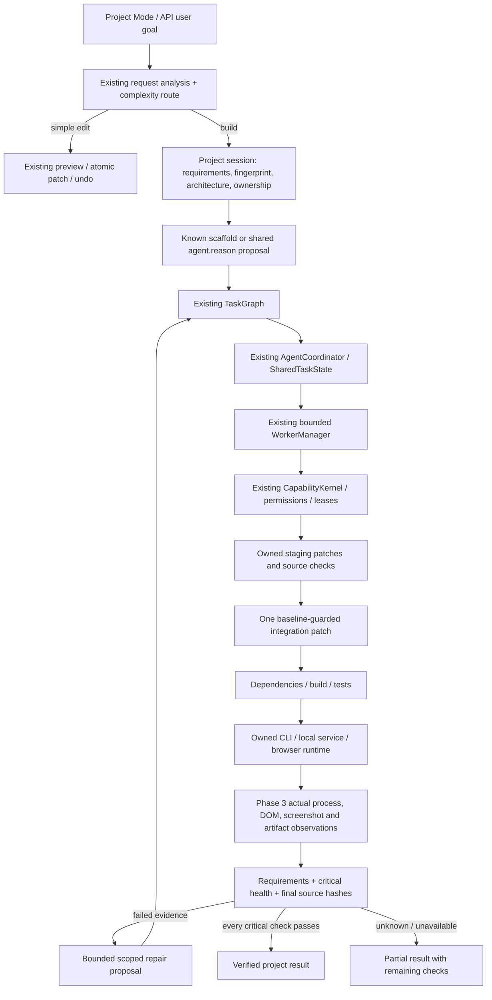

# Project Builder 2.0

Project Mode now creates a persisted build session and uses MORICE's existing kernel, agent coordinator, workers, task state, permission authorities and verified actions. A file manifest is a proposal. A successful file write or command is not a completed application.

`RuntimeServices.autonomous_builder.project_runtime` initializes the project extension lazily. Normal chat, direct PC actions, startup and small source edits retain their existing routes. Full projects run in the existing background task infrastructure; workers are dispatched by the Phase 2 coordinator. Chat is available after the build starts. Project output shows milestones and the final requirement/health result.

## Architecture



There is no second agent system, worker scheduler, permission system or model loader. The additions to Phase 3 are shared `process.start`, `process.stop` and `browser.inspect` capabilities. Tester and Browser roles use those capabilities through the same coordinator and action verification boundary. Persistent application capacity uses the existing ResourceManager. At most two background application log readers retain an 8 KiB tail each; they do not perform agent work.

## Session and completion contract

A session records the original goal, requirements with origin/category/check/status/evidence, assumptions, environment fingerprint, architecture, ownership, proposed changes and reviewed hashes, discovered commands, dependency information, task graph summaries, worker outcomes, issues, repair attempts, artifacts, screenshots and metrics. Requirements are user requested, inferred defaults, optional suggestions or technical necessities. Unsupported checks remain `not_verified`.

Source, dependency, build, test, runtime and artifact health are critical. Web projects also require UI health. Each health value is `pass`, `fail`, `warning`, `not_checked` or `unavailable`. Only `verified` is success: every critical health value must pass and every nonoptional requirement must have independent evidence. An archive, a generated title, a model statement, a successful test process, or a screenshot by itself cannot satisfy a full requirement.

Checks currently supported are actual CLI output, explicitly declared layout geometry, browser interaction results, local API responses and actual artifact identity. CLI output checks require nonempty expected text. Layout checks require declared criteria. Broader natural-language semantics do not become true because a model generated code; they remain unverified until an appropriate observable contract is supplied. The addition CLI scaffold automatically supplies acceptance only for the narrow explicit addition request; it cannot certify multiplication, GUI, history or general calculator functionality.

## Ownership and integration

Each changed path has one owner. Explicit glob ownership must match exactly one worker; overlapping, duplicate Windows identities and unsafe names fail planning. Default scopes group frontend, backend, tests and central configuration. Each scope receives a bounded private copy under `.morice-build/<session>/workspaces/<owner>`. Workers write only their own patch paths through the existing Coder role and run actual source checks through the Tester role.

Private copies have their own hashes. Integration retains the reviewed project hashes, checks actual staged output and applies one atomic patch through the existing tool/UndoStore. Final readback verifies hashes again after build/runtime/package checks. User edits appearing after the owned patch prevent automatic repair. No Git checkout, stash, reset, clean, commit, merge or push is required for staging. Unrelated dirty files stay in place.

Staging is limited to 6,000 copied files, 2 MB per file and 20 MB per copy by default. Source proposals are limited to 80 files and 20 MB total. Up to eight distinct ownership scopes are allowed. Resolved paths, Windows device/ambiguous names, symlink escapes, secret paths and generated metadata paths are rejected. Cache paths are also checked against the authorized root; a redirected `.morice-build` cannot write elsewhere.

## Commands, dependencies and runtime

Discovery extends existing project/workflow adapters and actual manifests. Web and Python helpers perform real source checks, dependency checks, archive builds and tests. Python projects declaring simple explicit requirements get a project-local `.venv` and actual pip installation; unsupported URLs/VCS/options are refused. Existing environments are preserved and environments redirected outside the project are rejected. A missing dependency, tool, test command, entry point or editor is reported. A zero-test unittest/pytest run is not green.

Node scripts and lockfiles determine the package manager and actual build/test commands; .NET, Rust and Go reuse existing discovered commands. Other existing adapters remain discoverable. Discovery alone is not platform validation. An explicit runtime contract and expected real artifact can extend the validation for another installed toolchain. No fake executables, APKs or other binaries are emitted from text manifests.

CLI runs capture actual exit status and bounded diagnostic evidence. Long-running web/services use owned Popen processes; startup readiness checks run in the project driver, outside the bounded worker pool. Local API checks can compare status, response text and JSON. Browser work uses the existing attached Qt profile/pages and Phase 3 navigation/interaction verification. Inspections capture actual PNG bytes and actual DOM rectangles, visibility, text, font sizes, overflow and console errors. Requested responsive viewports must equal the actual rendered viewport. Geometry and image metadata do not imply full semantic vision.

Actual archive contents are checked against the session's integrated source hashes. Expected native artifacts must exist, be nonempty, remain inside the root and pass the shared artifact verifier; supported archive formats are reopened and checked. Source archives do not claim compilation to a native executable.

## Repair, updates, cancellation and resume

Defaults are three changed repair rounds, two attempts per issue, eight shared model calls, the Phase 2 token budget and 300 seconds for a build. Proposal generation additionally has a maximum 60-second stage bound, clamped by the configured wall limit. Physical teardown has short separate cleanup deadlines; cancellation never releases leases for work that has not actually stopped.

Actual failure output creates bounded, deduplicated issues. A repair must change source, stay within scope and preserve acceptance tests. Repeated/no-op repairs and test removal are rejected. Every repair reruns dependencies, build, tests, runtime, observation, artifacts and final source checks. The configured shared model adapter can propose a compact one-file repair from actual logs; an API callback can supply a broader reviewed patch. No backend, an oversized repair, exhausted budgets or a missing verifier produces a clear partial/failed result.

`update_requirement` preserves requirement identity, increments the revision and invalidates downstream health at graph boundaries. `cancel` stops the session's linked token; owned processes are torn down through existing process control. The GUI supports Stop, build status and `update build requirement: ...`; Project changes also has Resume build. Resume loads a typed checkpoint, checks current hashes, obtains fresh authority and reruns verification. It does not reuse approval tokens or blindly replay applied patches. If applied files changed, resume preserves them and requests a new plan/review.

## API

```python
from morice.kernel import ExecutionContext
from morice.project_build.contracts import Requirement

builder = services.autonomous_builder.project_runtime
session = builder.create(
    project_root, "Build a Python addition calculator", manifest,
    requirements=[Requirement("2 + 3 produces 5",
        check={"kind": "command_output", "contains": "5"})],
    runtime={"kind": "command", "command": [python_path, "main.py", "2", "3"]},
)
result = builder.build(session, ExecutionContext(project_id=project_root),
                       authorize=existing_scope_authorizer)
assert result.status in {"verified", "partial", "failed", "cancelled"}
```

The authority callback is supplied by the caller's existing approved policy. The builder does not manufacture tokens. API callers may configure `services.agents.models` with the existing `ModelReply` callback contract and use `builder.generate` for a source proposal. Generated commands, approval fields and runtime assertions are ignored; discovery and independent checks determine behavior. Generation calls count against the subsequent build's shared budget. GUI generation and repair use the selected existing `stream_chat` backend, not new per-worker model instances. Where backend token usage is unavailable, reported counts are estimates; admission uses conservative byte/output bounds.

## Safety and current boundaries

Secret files/keys are excluded from staging, model snapshots and source archives. Credential assignments and known secret environment values are redacted in diagnostic checkpoints/context; credential material in generated source is rejected. Repository text and command output are explicitly untrusted data and cannot provide permission tokens. Snapshots select entry points/requested files before other bounded source content. Git inspection is read-only. Known commit/push/merge/tag/rebase/reset/clean/publication commands are rejected by the local-build driver. No source-control or external publication operation was performed in this phase.

This is not an OS security sandbox. Arbitrary project code and package scripts can have indirect effects; static command checks cannot prove hostile code harmless. Existing permissions still govern command execution, exact browser clicks/submits/uploads and denied capabilities. Full access does not override denied/unsupported/OS-gated permissions. Advanced isolation for adversarial code is a remaining technical constraint.

Validated platforms here are a Python CLI, Python local environment preparation, a local Python HTTP API and a responsive HTML/CSS/JavaScript application in actual Chromium. Android/device, Unity/Unreal/Godot editor/play-mode, .NET/native GUI, database persistence/auth and screenshot-reference semantic similarity were not validated end to end. They require installed tooling, observable contracts and appropriate providers. Generic desktop UIA/semantic vision remain the Phase 3 provider constraints. Online documentation is not automatically added to the compact shared generation prompt. A source archive or available adapter cannot turn those missing checks green.

See `project-builder-2-report.md` for the 61-item delivery report and `project-builder-2-audit.md` for the fresh audit. Reproduce the controlled effects with `scripts/demo_project_builder.py`, the comparison with `scripts/benchmark_project_builder.py`, and startup with `scripts/verify_builder_startup.py`. The frozen spec includes the helper source; a frozen Python build still needs an installed Python interpreter. The validated wheel is a local source package, not a new portable executable or public release.
