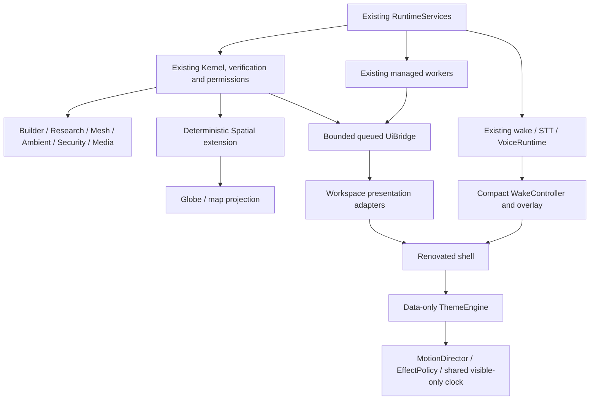

# Renovation architecture

Current acceptance, 2026-10-15: **1,077 tests and 62 subtests pass in 398.39 seconds**. Matching native wheel/frozen and installed checks pass; all twelve themes visibly animate, the composer stays inside the screen and navigation appears once. Native cached vector curves have closed position/velocity cycles. [Final software evidence](release-audit-evidence.json) supersedes earlier global gates; measured performance and hardware/provider limits remain explicit. Historical observations below retain their original scope.

This document describes implemented components, not completion. The working gate and retained limitations are in [renovation-progress.md](renovation-progress.md). The production window factory selects the new shell and current package/install gates pass. Hidden compatibility construction remains a documented startup/memory cost.

## Execution ownership

Every renovated destination receives the same `RuntimeServices`. CapabilityKernel, AgentCoordinator, TaskGraph, WorkerManager, SharedTaskState, leases, verification and permissions retain their existing authority. UI navigation never grants a permission, starts a model, enables a connector or pairs a node. Simple ordinary actions retain the existing direct router; a cheap Spatial eligibility check avoids unnecessary admission to the UI/agent queues.

Existing managed Media, terminal and background-process owners share a low-level Windows Job utility in `process_ownership.py`. It establishes family ownership before resuming a newly created root, then verifies the Job is empty during bounded cleanup. Windows wheel metadata now requires psutil in the base runtime (the legacy optional media-tools extra remains compatible). Initial threads are queried by the existing psutil native implementation; process/thread handle identity, exactly one initial thread and its suspension count are checked before resume. This avoids a Python loop over every system thread during GUI painting. This covers launcher children that a PID-tree snapshot can miss, including when the root has exited. It adds no Kernel, permission system, resource manager or agent pool. Non-Windows process groups retain their existing behavior. See [Microsoft's Job Object contract](https://learn.microsoft.com/en-us/windows/win32/procthread/job-objects). Abrupt termination between suspended creation and assignment remains a narrow, unvalidated startup interval; denied assignment or unexpected initial threads fail closed.

`UiBridge` submits bounded operations to existing general workers and delivers results on the GUI thread. It permits 32 pending deliveries and coalesces/bounds queued public Kernel events at 256. Its allowlist excludes private reasoning. Views do not wait for heavy jobs in a general worker: Media submission returns the scheduler identifier/future immediately; the scheduler owns resource waits. Research large reads and comparison preparation use existing workers; hidden refresh timers stop.

## Presentation

`shell.py` owns navigation, chrome, composition and integration hooks. `workspace_adapters.py` retains reviewed existing action callbacks/forms for Builder, Research, Mesh, history, plugins and Ambient/Security. `settings_view.py`, `media_view.py`, `activity_view.py`, `research_graph.py` and `spatial_view.py` define their own presentation. The current migration still inherits the established window presenter and retains a hidden child compatibility host. This is tracked technical work, not a final claim that obsolete UI has been removed.

Public Activity rows come from actual Kernel events, bound to 128 recent tasks and 200 public events. Hidden Activity retains bounded presentation data and resets its model when shown instead of changing hidden event-list widgets for every task. Research graph displays stored record/provenance/revision/stale metadata and stored relationship edges only, up to 200 nodes; it infers no scientific support.

## Tokens, themes and effects

`AppearanceProfile` is schema-validated data. Imports reject unknown fields, executable/style/path content, invalid colors and unbounded numbers. Atomic internal preference writes and bounded imports preserve corrupt files. Presets are MORICE, GLASS, OBSIDIAN, ICE, AMETHYST, MIDNIGHT, NEON, MONOCHROME, CUSTOM, ARCTIC, SOLAR and CRIMSON. Each has its own authored geometry and motion. Background and surface foreground roles are distinct; primary hover/pressed, status and focus roles are contrast-adjusted. The token store owns font/scale/density/radius/colors/material/motion/effects.

Theme styling is scoped to the renovated presentation tree. Separate wake/palette/notification/diagnostic surfaces receive the same tokens. Retired compatibility controls are not deliberately repolished on every live theme edit.

Effect quality preserves the selected LOW/BALANCED/HIGH/ULTRA preference while reducing the effective budget under existing media/GPU/memory/power states. Optional backdrop material is generated locally at at most 640×400, blurred and cached. Glass is an opaque app-surface material blend; it is not Windows desktop acrylic or screen capture. Background particles are bounded at 0/20/36/48 before reduced-motion/load adjustments, repaint small dirty regions and share the clock. Cursor light uses bounded local dirty rectangles and cached weak visible targets. Magnetic paint translation does not move hitboxes.

MotionDirector provides bounded interruptible Qt property animations. The effect clock stops without visible active subscribers. Retained scientific canvas timers use `RendererClockAdapter`; meaningful Physics stepping keeps the existing engine and bounded timestep accumulation, while decorative orbit/pulse follows reduced motion. Retired Galaxy polling is stopped. Native QObject slots/lifetime tracking avoid delayed Python closures using deleted Qt receivers.

## Authored icons and simpler controls

`icons.py` contains 62 original vector marks on a 24-unit grid. The authored paths render once into native QIcon backing at seven DPR levels from 100–300%, held in a 128-entry cache. Native button painting no longer reenters a Python QIconEngine; normal, disabled and checked colors remain explicit. The proxy style has an application-lifetime Python owner. Glyphs are not taken from fonts or a stock pack. UiIconBinder covers the owned presentation, lazy controls/tabs/actions and owned dialogs; the proxy style supplies authored standard-icon requests and control indicators. Qt file dialogs retain selection semantics with an authored file icon provider. ComboChevron retains a visible custom selection affordance when QSS suppresses native arrows. The logo is separate and byte-identical to the original HEAD asset.

Navigation separates eight everyday workspaces, seven additional workspaces behind More, and History/Settings in the footer. All routes remain searchable and keyboard reachable. Appearance shows common controls first and reveals searchable advanced settings. The existing prompt editor's configurable bounded document height produces a compact empty composer and a larger scrolling editor for long input.

Cursor glow levels differ in radius and opacity, with policy caps under load. Smooth following, up to three nearby reactive edges and a brief click pulse use local dirty regions. Optional trails remain eight points/180 ms. Keyboard navigation clears pointer decoration. Reduced Motion immediately snaps active button spring state to zero and removes the trail/pulse. Clock callback cost remains distinct from native paint and compositor timing.

## Wake and voice

WakeController is presentation state and request ownership over the existing listener/STT/VoiceRuntime. It creates no recognizer/router/worker pool. The overlay uses the same original orbital Core renderer, real cheap PCM level access, bounded transcripts and non-activating tool-window flags. Existing STT/TTS request IDs, a Kernel cancellation token and interaction epoch reject stale responses and reopening after cancellation. The main window opens only after an explicit visual command succeeds. Fullscreen detection reuses the existing foreground probe. Small/normal/audio-only/disabled overlay policy preserves the selected preference; follow-up idle/command/work timeouts are bounded.

The previously reserved `local` TTS provider now implements the existing provider protocol with Windows SAPI PCM on the existing VoiceRuntime worker. No new speech runtime exists. The default provider and credentials remain the existing user preference. Actual local PCM/Vosk proofs are separate from physical microphone/speaker or cloud claims.

Normal deterministic replies also update the wake presentation. Disabled reply speech remains silent and allows a follow-up. Queued TTS and its pending request ID retain Working until the existing playback completion callback arrives; an inactive playback worker alone is insufficient evidence to rearm the microphone. The corrected actual SAPI/Vosk demo again produced exactly six complete replies with no aborted sinks.

Media status reads do not periodically search PATH for optional encoders. Tool diagnostics are explicitly NOT_CHECKED initially, then cached after user-requested resource refresh. That probe uses the existing background executor. Explicit probing can still depend on filesystem responsiveness; it is separated from interactive status polling.

## Spatial

`RuntimeServices.spatial` lazily registers 11 capabilities in the existing Kernel. Typed WGS84 coordinates reject non-finite/bool/out-of-range data. GeographicLib computes surface geodesics, bearings, radius, polygon area and real path samples. ECEF chord is explicitly distinct; supplied altitude is accepted, terrain is never inferred. Routing remains unavailable without a real provider.

The indexed read-only GeoNames cities15000 snapshot has 34,154 cities and exact normalized aliases, with CC BY 4.0 attribution and source hashes. Ambiguity is shown as actual candidates and requires selection. Natural Earth 1:110m land is public-domain offline geometry. Coverage limitations, source/version/algorithms and spherical-display versus WGS84-computation scope are visible. No device tracking/GPS is enabled.

Globe is an interactive software orthographic spherical projection. Map is equirectangular with date-line breaks. Surface paths render real computed samples, chords use a distinct straight projection, markers originate in domain/Kernel state, and click coordinates become explicitly supplied points. Quality scales atmosphere/cache/effects. Radius, area, multi-point and marker controls dispatch the same registered capabilities, with no widget-side distance engine.

## Evidence and release gates

The original logo PNG bytes remain unchanged; rendering uses the original high-resolution asset directly at native DPI. Controlled wake→Spatial proof uses actual SAPI PCM, Vosk confidence, existing handoff, UI callbacks, six actual complete PCM replies and deterministic math. Controlled workspace proof includes a real 10,000-run stored sweep, verified local build, mutually authenticated localhost TLS transfer and the actual Phase 9 verified image.

First full regression passed 1,004 tests and 62 subtests. It is a mid-migration result. Native geometry/visual checks, compatibility review, full parity matrix, final workload/idle/frame/soak metrics, final regression, clean wheel/frozen package and the revised cinematic 102-item report remain gates. Local screenshots are test evidence only. Phase 11 publication, README refresh, commits, release and public screenshots are not started.

## Cinematic presentation ownership

`core_state.py` projects bounded public events and actual cheap voice status/RMS reads into fifteen states. It schedules no work and retains no prompt or private reasoning. Existing Kernel and WorkerManager publish minimal public requirement/role/state metadata, preserving original TaskGraph, SharedTaskState, leases, authorization and verification. A bounded one-shot outcome timer resets temporary completion/attention presentation; cosmetic clocks stop when hidden or minimized.

`core_view.py` paints original spline orbits, actual public role/capability satellites and PCM-driven waveform accents. Cached Core geometry has a 64-entry bound; native painter transforms carry rotation. `energy_field.py` draws fine contours as native antialiased vector paths on every shared-clock animation frame. Smooth themes use cubic splines; faceted themes retain intentional crisp corners. Only diffuse light uses cached small rasters at 4/12/16/20 Hz for LOW/BALANCED/HIGH/ULTRA, bounded to 256×144 / 336×210 / 432×270 / 560×350. Paths and particles have closed, differentiable cycles; no edge-wrapping jump or low-resolution line texture is used. One current path cache is retained. No video, GPU lease, desktop capture or second worker pool is used. CPU raster/widget paint samples are explicitly distinct from compositor presentation. `materials.py` is only a compatibility alias to this single renderer.

EffectPolicy aggregates independent media/lease/metrics/power/focus sources. Reduced Motion removes moving trails, particles, pulses and field drift. Active LOW/battery mode retains inexpensive animation with four scene layers and four diffuse-raster updates per second; crisp contours follow the shared clock. Inactive/minimized windows pause decoration and retain readable materials and marks. CursorLighting's existing owned-pointer event path supplies the field's local response; native hit areas and pointer remain unchanged.

`action_deck.py` supplies bounded contextual disclosure and accessible route buttons. The Core home suppresses permanent rail/dashboard telemetry. `appearance_profile.py` is a strict Qt-free data contract shared by the live engine and existing named profile store. `profiles_view.py` preserves the existing permission checks/store. WorkspaceState adds validated route/navigation fields without replacing legacy session data, and renovated child windows reuse the same runtime. The production factory migration is implemented; final matching packages and installed-dist acceptance remain gates.

Normal launch and the package probe now share `pyside_app.create_application_window`, which creates RenovatedWindow over the caller's existing runtime. Pet/background wake activation still enters the existing launcher/single-instance protocol. There is no new execution service or standalone staged launcher. The normal launch path also clears application identity and shuts down the runtime if window construction raises. Hidden compatibility widgets still retain established controller bindings; removing that retained construction is a separate cleanup gate.

The orbital painter combines counter-rotation, staggered vertical lift, changing plane tilt and restrained breathing around a fixed central light. Cached bounded geometry uses native transforms; each scene has its own closed pose cycle. Animation strength scales displacement, while zero strength and Reduced Motion settle to a deterministic static phase. Active LOW quality continues bounded motion. Appearance updates avoid repeated unchanged styles and bind hidden controls when they show; an identical profile value no longer triggers a redundant theme broadcast.

Workflow completion uses the existing coordinator's actual aggregate status. Core success notices are suppressed during active workflows, so a later successful branch cannot conceal a failed graph. UI event coalescing keys include task, workflow, generation or finding identifiers and move updated entries to the end; distinct incidents/workflows do not collapse into one. Notice severity prevents lower-priority outcomes from replacing a still-visible error/security report. Owned dialogs and menus receive the same live stylesheet and authored icons as the primary presentation.

Lazy owned model surfaces no longer run the old galaxy timer or paint its former material. UiIconBinder supplies the static token-based surface while preserving its controls/callbacks. The existing RichContentView receives a bounded palette/font CSS mapping, reapplies it after load and remeasures after changes. Its JavaScript uses a local scope so repeat updates cannot collide with a prior declaration. Appended formatted responses receive current tokens; identical mappings avoid unnecessary script delivery. This extends the existing renderer without introducing another browser or execution authority.

Research result presentation uses the existing VirtualLaboratory manager with parameterized SQL filtering and a 500-row limit. Matching counts include all stored runs; complete exports keep their full default. Raw database rows are fetched and read cursors closed before JSON decoding, so that work does not retain shared SQLite reader locks. Search covers displayed indices, parameters, status, outputs and errors with Unicode casefold and literal matching. No journal-mode migration is introduced. SQLite 3.50.4 in the current Python environment predates the upstream WAL-reset fix, so a WAL experiment was removed; manually configured WAL databases and network filesystems are not certified by this change. See [SQLite WAL constraints and advisory](https://sqlite.org/wal.html).

The preexisting AmbientStore still uses WAL through one SQLite connection serialized by its RLock and the single RuntimeServices authority. That differs from the rejected Research change, which would have introduced concurrent connections to the shared knowledge database. Independently running multiple processes against the same Ambient database on the bundled older SQLite is not certified; upgrade to an upstream-fixed SQLite before relying on concurrent WAL writers/checkpointers. No comprehensive dependency-CVE certification is claimed.
