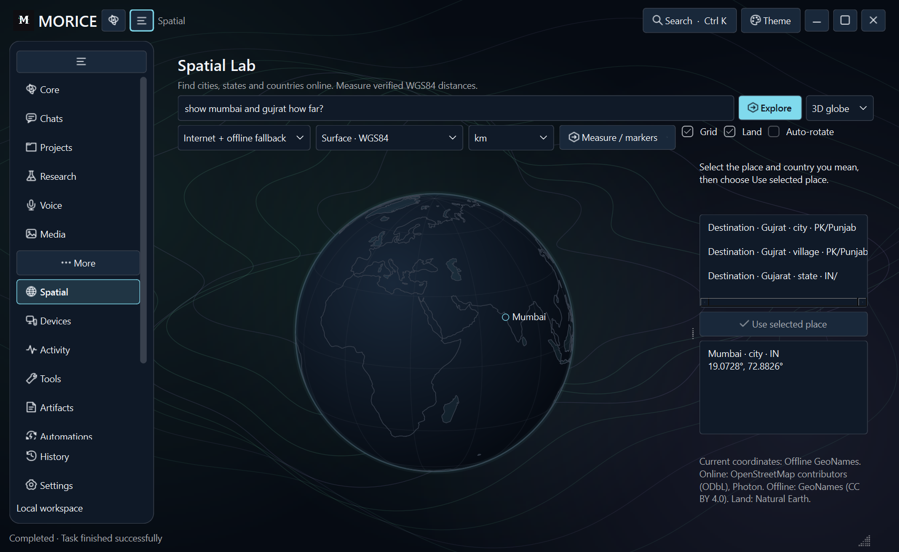
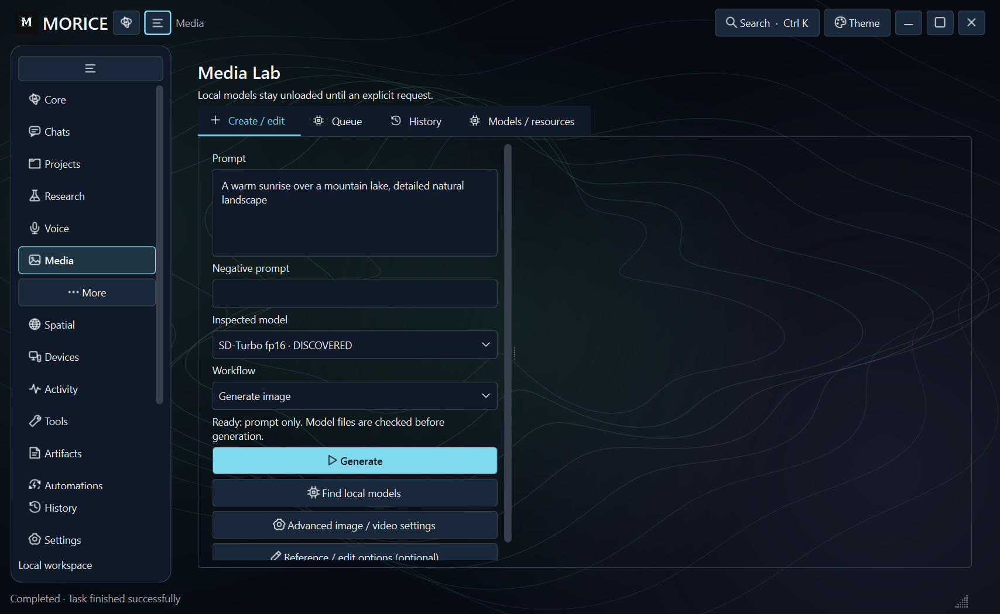

# Locations and prompt-only images

## Find places and measure distance

Open **Spatial**, keep **Internet + offline fallback** selected, and enter `show Mumbai and Gujarat how far?` or `Mumbai to Karachi`. Press **Explore**. You can also enter a single place such as `Pakistan`. Online search includes cities, states, countries, villages and other named places instead of limiting queries to the installed city extract.

For `Gujrat`, select **Gujarat · state · IN** or **Gujrat · city · PK**, then press **Use selected place**. MORICE does not silently change the country. The result shows WGS84 surface distance or the selected straight 3D chord. Units remain selectable. State/country points are provider-supplied representative coordinates; these measurements do not mean distance to a border or a road/driving route.

Names such as New York or São Paulo can also identify more than one place type. Choose the city, municipality or state you mean from the returned choices; an exact spelling does not make an ambiguous name unique.

Queries run only on an explicit search, with bounded responses, deadlines, at most one outgoing request per second and a one-day cache. Repeated searches use the cache. Offline mode uses GeoNames cities and supplied coordinates. If the online provider is unavailable or network permission is denied, the displayed coordinate sources identify the offline fallback. A place absent from both sources produces an error without inventing coordinates.

If another Spatial command is running, a second command reports busy immediately rather than waiting in a worker. In Chats, use **find place Paris** for an explicit place lookup; generic **locate my notes.txt** requests retain the existing chat/file route. Inside Spatial, bare place names and **locate Paris** are accepted.

Online data: [Photon API](https://github.com/komoot/photon/blob/master/docs/api-v1.md), [server usage terms](https://github.com/komoot/photon#demo-server), OpenStreetMap contributors (ODbL). The public demo has no uptime or exhaustive-coverage guarantee and can throttle heavy usage. Set `MORICE_GEOCODER_URL` to a compatible HTTPS Photon endpoint for your own service. This integration performs individual place searches; it does not download every address, boundary or point of interest.

## Generate an image without a reference

1. Open **Media → Create / edit** and choose **Generate image**.
2. Select an installed image model, type a prompt and press **Generate**. A reference image and mask are not needed.
3. A discovered model is checked when you press Generate. The visible hint explains missing models, incompatible workflows or dependencies. **Find local models** discovers the configured model folders; **Models / resources** retains explicit inspection controls.
4. Follow actual stages under **Queue**, then inspect verified outputs under **History**.

**Reference / edit options (optional)** contains reference selection and Clear. Choosing an image switches to Edit reference. Inpainting requires its source image and mask; selecting Generate image again submits the prompt without reading those files. Clearing the reference resets prompt-only generation.

Dimensions, steps, seed and other controls are under **Advanced image / video settings**. Both sections start collapsed so the prompt, model, workflow and Generate action stay together.

An enabled Generate button means the request can be prepared. The shared planner still checks actual RAM/VRAM and the backend before generation. The already installed SD-Turbo bundle is retained. Available RAM ranged from about 2.8 to 4.3 GiB during these checks, below the roughly 5.7 GiB needed, so new real-weight inference remains constrained as previously documented. Controlled worker tests establish submission and artifact handling, not new model quality. No extra weights are downloaded automatically.
