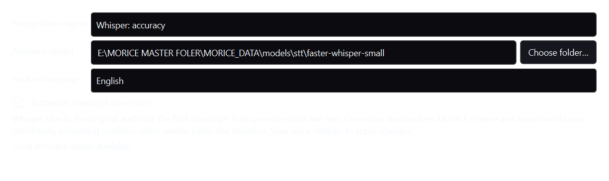

# Speech input and spoken replies

MORICE uses Vosk for quick streaming text and wake detection, with **Whisper Small** available for the final speech transcript. The installed profile selects the larger local recognizer. English, Hindi and automatic language detection are available under **Settings → Voice → Speech recognition quality**.

Select Automatic, Whisper or Vosk, choose a local converted Whisper model folder and save voice settings. The folder needs `model.bin`, `config.json`, `tokenizer.json` and `vocabulary.txt`. Public downloads include the decoder; the Whisper weights are acquired separately through an explicit user action. The app loads local files and performs recognition offline.

The selected model is [Systran/faster-whisper-small](https://huggingface.co/Systran/faster-whisper-small), the MIT-licensed CTranslate2 conversion of OpenAI Whisper Small. Its model files and README total **486,214,370 bytes** at revision `536b0662742c02347bc0e980a01041f333bce120`. The main weights have SHA-256 `3e305921506d8872816023e4c273e75d2419fb89b24da97b4fe7bce14170d671`. The [faster-whisper project](https://github.com/SYSTRAN/faster-whisper) documents CPU INT8 execution.

The microphone closes before final decoding. The owned decoder uses four CPU threads, a 3 GiB Windows Job memory limit, bounded audio/messages and a processing deadline. Cancellation reaps its process family. Voice warmup loads the decoder for the current session; leaving voice closes it and releases its resource lease. Text-only startup retains lightweight speech prewarm.

Whisper refines the actual recorded audio. Automatic text correction standardizes MORICE/Morris/Maurice when addressing the assistant, and corrects known workspace-command inflections such as “MORICE opens settings” to “MORICE open settings.” It preserves request arguments, numbers, other names, URLs, file paths and negation. The correction stage performs no free-form request rewrite. Speech diagnostics retain the current live, raw and corrected text in memory. Audio is discarded after processing.

Silence and low-confidence recognition are reported. Unclear recognized speech asks for repetition. If the larger decoder fails, the actual Vosk fallback is labelled in the result and shown as a notification; diagnostics identify the recognizer used.

In voice mode, generated reply text feeds the existing TTS pipeline. ElevenLabs uses the configured voice, model and stored API key. Windows local speech uses installed system voices and supports streamed reply chunks. Playback PCM levels drive the app and Orb speaking animation.

Validation uses owned Windows-synthesized audio: ordinary commands, negation, quantities, assistant naming and a reasoning question, plus quiet audio, silence/noise and actual worker cancellation. It also exercises packaged decoding and a local language-model-to-TTS pipeline. These fixtures verify operation and specific cases; they do not certify accuracy for every microphone, accent or acoustic environment.
