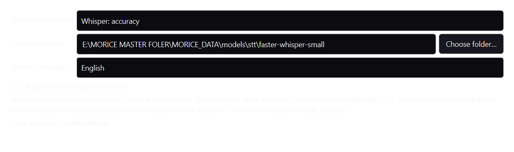

# Speech input and spoken replies

MORICE uses Vosk for quick streaming text and wake detection, with optional local **faster-whisper Large v3 Turbo** or **Whisper Small** for the final transcript. Automatic model discovery prefers an installed Turbo model over Small. An explicitly selected model folder takes precedence. English, Hindi and automatic language detection are available under **Settings → Voice → Speech recognition quality**.

Selecting Voice explicitly starts its session. Merely restoring a saved Voice page leaves devices off until a microphone or camera control is activated. Camera startup, unavailable-device and error messages stay visible and can be cancelled. Device indicators refer to MORICE's own capture. Late speech deliveries are ignored after pause/resume, reconfiguration or session replacement.

## Choose and install a recognition model

Select **Automatic**, **Whisper** or **Vosk**, choose a local converted Whisper model folder if needed, and save voice settings. Vosk uses the lightweight recognizer without final Whisper refinement. A compatible CTranslate2 folder needs `model.bin`, `config.json`, `tokenizer.json`, and either `vocabulary.json` or `vocabulary.txt`. Keep the model's other supplied configuration files with it.

| Optional accuracy model | Approximate storage | Model source snapshot |
| --- | --- | --- |
| Large v3 Turbo | 1.6 GB | [CTranslate2 Turbo conversion](https://huggingface.co/dropbox-dash/faster-whisper-large-v3-turbo/tree/0a363e9161cbc7ed1431c9597a8ceaf0c4f78fcf) |
| Small | 486 MB | [Systran Small conversion](https://huggingface.co/Systran/faster-whisper-small/tree/536b0662742c02347bc0e980a01041f333bce120) |

Both referenced conversions are MIT-licensed. Their size is a storage requirement; decoding needs additional working memory. The [faster-whisper project](https://github.com/SYSTRAN/faster-whisper) documents CTranslate2 conversion and CPU INT8 execution.

Public Windows packages include the accuracy decoder, its native dependencies and VAD data, plus the small Vosk wake/live-transcription model. **Turbo and Small weights are separate downloads.** Install or select them explicitly; the application loads local model files and does not download accuracy weights during recognition. Recognition remains local and offline.

## Latency, warmup and cancellation

The microphone closes before final decoding. The accuracy worker uses CPU INT8 and a bounded CPU-thread count. Large checkpoints have a 4 GiB Windows Job memory limit; smaller checkpoints use 3 GiB. The higher limit accommodates temporary model-loading/conversion memory and is separate from steady-state use or the total RAM needed by the application.

An explicitly started voice session can warm the accuracy decoder in the background. A cold request includes worker startup and model loading; later requests in the same warm session can reuse it. Storage speed, model size and competing work affect response time. Leaving voice closes the owned decoder and releases its resource lease. Text-only startup keeps lightweight speech prewarm.

Audio, messages and processing stages are bounded. The wake interaction's **Refining speech…** state and the packaged speech check share a completion budget derived from the recognition runtime's capture, warmup-wait, loading and decoding deadlines, with cleanup time allowed. These budgets define when waiting stops; response time still needs to be measured on the actual hardware. Cancelling or replacing the interaction interrupts waiting and reaps the owned worker process family. A packaged speech-check failure is returned as a structured result.

## Transcripts, wake and spoken replies

Whisper refines the actual recorded audio. Automatic text correction standardizes MORICE/Morris/Maurice when addressing the assistant, and corrects known workspace-command inflections such as “MORICE opens settings” to “MORICE open settings.” It preserves request arguments, numbers, other names, URLs, file paths and negation. The correction stage performs no free-form request rewrite. Speech diagnostics retain the current live, raw and corrected text in memory. Audio is discarded after processing.

Silence and low-confidence recognition are reported. Unclear recognized speech asks for repetition. If the larger decoder fails, the actual Vosk fallback is labelled in the result and shown as a notification; diagnostics identify the recognizer used.

Background Helper and the optional Orb pet coordinate ownership of the existing Vosk wake listener. The helper yields its listener before starting question capture, so a helper voice interaction reuses the app's speech-input owner. See [Background Helper setup](background-helper.md) for the separate wake, microphone and selection options.

Changing speech-input quality preserves the existing ElevenLabs provider, configured voice/model and stored API key. Generated reply text continues through the existing TTS pipeline. Windows local speech remains an available provider, using installed system voices and supporting streamed reply chunks. The selected provider and fallback preferences control playback. Playback PCM levels drive the app and Orb speaking animation. Public packages contain no user's API key or saved personal voice profile.

## Validation scope

Controlled validation uses Windows-synthesized audio for commands, negation, quantities, assistant naming and a reasoning question, plus quiet audio, silence/noise and actual worker cancellation. Packaged decoding and local language-model-to-TTS checks exercise their specific pipelines. A synthesized-audio transcript, a model-loading deadline or a provider playback receipt does not establish physical-microphone accuracy or universal response time.

Physical wake detection, accents, room noise, input-device selection, camera/driver compatibility and speech-provider latency need acceptance in the actual environment. Background Helper's physical gesture and mixed-DPI checks are separate from decoder tests. Check the recognizer/provider diagnostics and the current release's validation record for the exact observations and remaining limits.
