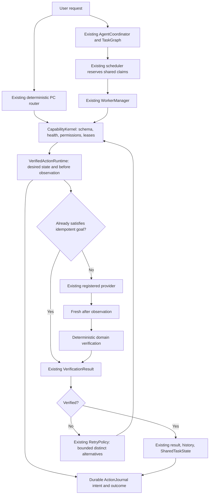

# Verified Action Runtime — Phase 3

Phase 3 adds observed action outcomes to MORICE's existing capability kernel and Phase 2 agent runtime. A provider's successful request is an execution attempt. A mutable task succeeds only after fresh domain evidence proves its requested state. An unobservable result remains inconclusive.

## Execution and ownership



The optional `kernel.actions` hook has no separate executor, permission manager, worker pool, graph, or resource manager. `ActionBinding` connects an existing capability to a desired-state builder, observer, verifier, and optional provider override. The kernel still owns retries, deadlines, cancellations, final results, and leases. All nine Phase 2 production roles remain in their registry.

The parallel scheduler atomically reserves the existing claims before it submits a worker. Resource contenders remain in DAG admission instead of occupying workers. Internal reservations travel through the compact WorkerManager context. Actual executing work owns release, including detached work after a timeout. Retry alternatives with different claims and direct kernel calls retain the existing cancellable resource wait.

## Contracts and goals

`ActionSpec` identifies the action, task, goal, target, registered capability, method, desired state, verification level, observation bounds, freshness, and expected outcome. `Observation` identifies its source, state, timestamp, evidence, errors, and raw reference. Its confidence is descriptive and is never a success threshold.

Default observations allow three seconds and 40 polls, with adaptive cancellable intervals from 10 to 200 ms. Configuration is clamped to ten seconds and 100 observations, always within the existing kernel deadline. Evidence older than two seconds, substantially future-dated, mismatched to the action, or containing observation errors cannot certify success. A structured `VerificationPolicy.expected_outcome` must match real observable fields; unsupported expectations remain inconclusive.

The current verification levels preserve a minimum independent domain check. BASIC, NORMAL, STRICT, and DOMAIN_SPECIFIC do not yet impose different application-specific proofs. NONE cannot certify a mutable operation.

The method vocabulary orders application API, operating-system API, filesystem, CLI, browser DOM, accessibility, foreground control, and vision. Installed bindings prefer actual API/OS/filesystem/CLI/DOM providers. Accessibility and general foreground input are extension points without an installed implementation; vision remains an optional observer. The runtime never invents a provider or lets a model choose an unregistered method.

## Supported providers

| Domain | Registered actions and evidence |
| --- | --- |
| Applications | Open, focus, restore, maximize, minimize, close, close others; actual process identity/family and usable windows |
| Browser | Open/navigate, back/forward/reload, find/click/type/submit/extract, tab open/switch/close, download; actual current URL/load/DOM/page/tab/download state |
| Files | Patch, undo, artifact verification; actual streamed hashes and size/existence. Open/reveal/recent need document/viewer association. |
| Processes | Existing `terminal.run`; owned, reaped process exit status, timeout/cancellation, stdout/stderr, and per-workspace build claim |
| Media | Volume, mute, playback, track changes and query; actual media-session state after execution |
| Vision | `vision.screen_observe`; existing screenshot and LiveVision provider, matching frame identity, cached semantic hypothesis |

The Qt bridge attaches to the existing AssistantHub browser view and profile. Worker requests run on the UI thread through signals and callbacks. DOM locators support role/name, labels/ARIA names, test IDs, and explicit selectors; matches must be unique. Input values are quoted data. Typing targets a DOM element and does not send keyboard input to whichever desktop window happens to be active.

Click and submit require an observable expected URL or text. A click acknowledgement alone is inconclusive. Generic click/submit/upload require exact existing permission-broker confirmation because their external effect cannot be inferred safely from a generic locator. Upload currently returns user intervention instead of automating a picker. Password, OTP, and CAPTCHA challenges also pause for the user.

Downloads use an approved root and new destination, real QWebEngine completion, and actual completed-file bytes/hash. Partial download suffixes cannot verify. Profile events from other windows are ignored. Tabs are bounded to eight owned pages; if the bridge is attached after an existing page is already loaded, tab ownership is not changed and tab actions require user intervention.

System-browser launching has no independent DOM observation and remains inconclusive. Search continues through the existing Phase 2 search capability; snippets are evidence to inspect, not verified navigation or instructions.

## Desktop state and input

The Win32 observer reports handle, process image/family, title, visible/enabled/minimized state, rectangle, DPI, and monitor. Application readiness requires a usable window rather than only a process. Known executable aliases, explicit PIDs, and handles are used; titles alone cannot establish application identity. Repeated open of a usable matching application is a verified no-op. Ambiguous targets and save dialogs block for user review.

`FOREGROUND_UI` remains exclusive for actions that control desktop windows. `BROWSER_SESSION`, `MEDIA_SESSION`, and hashed `PROJECT_BUILD:<workspace>` claims use the same ResourceManager. `FocusGuard` checks the target immediately before any future foreground input and abandons input if focus changed; it restores focus only while MORICE still owns the target, without fighting user input. No generic desktop keyboard/mouse provider is installed in this phase.

Geometry conversion uses observed physical window rectangles, monitor identity, and DPI. Tests cover 96/120/144 DPI and negative monitor coordinates; the real Win32 viewer fixture was observed at 120 DPI. Hardware with several physical monitors and third-party accessibility providers was not tested.

## Recovery, cancellation, and rollback

Alternative capabilities must be explicitly registered, distinct, and permitted. Their inputs must satisfy their own schema. The existing RetryPolicy controls the error allowlist and number of attempts. Identical failed action retries are suppressed; there is no infinite fallback chain. An unavailable primary can try a declared healthy alternative. Every attempt is observed and journaled separately.

Stop cancels the current PC action token or existing agent workflow. Qt queues with cancelled/expired contexts withhold commands and ignore late replies. Downloads are cancelled; owned terminal subprocess trees are terminated and reaped using the existing adapter. Cooperative work releases claims promptly. Native APIs that cannot be interrupted retain their claims until actual work stops, so a new action cannot overlap it accidentally.

`AgentCoordinator.restore(path, context=...)` uses the existing validated checkpoint. Interrupted actions can be reconciled through one fresh, authorized read-only observation when their claims are available. It does not replay the mutation, reuse an old permission token, or trust serialized success evidence. An unclear state remains blocked for review. Browser reconciliation must run on an existing background worker, because blocking the UI thread would prevent its own observation callbacks.

`services.actions.rollback(action_id, context)` dispatches the existing `action.undo` capability, requires the same nonempty workflow identity and fresh approval, and uses the existing UndoStore ownership/hash checks. Only tracked patch changes can be undone. Arbitrary application, network, upload, or purchase effects have no automatic rollback.

## Journal and permissions

The ActionJournal sidecar sits beside existing final ActionHistory. It is bounded to 500 attempts by default (configurable 10–2000), with durable intent before mutation and atomic final persistence. Polls do not fsync repeatedly. Final cancellation cannot be replaced by a late callback.

Records retain method, resource ownership, desired-state facts, before/after evidence, verification, errors, attempts, and timing. Password/token/credential keys and URL credentials are redacted; value, text, content, and goal fields are omitted. Page text, screenshots, prompts, model output, and command streams are not copied wholesale into this journal. Redaction is conservative field-based filtering, not a complete data-loss-prevention system.

Existing centralized permissions and the PC permission broker remain authoritative. Web/UI content cannot create approvals, install methods, edit policy, or become command input. Page text is untrusted evidence used only to compare user-declared outcomes. High-risk operations and exact confirmations stay in existing permission handling.

## Using the existing kernel

```python
from morice.kernel import ExecutionContext, TaskNode, VerificationPolicy

# Call from an existing MORICE background worker for Qt browser operations.
task = TaskNode(
    "browser.open",
    {"target": "https://example.com/"},
    verification_policy=VerificationPolicy(
        required=True,
        expected_outcome={"url": "https://example.com/"},
    ),
)
result = services.kernel.run_task(task, ExecutionContext())
# Existing permissions may require approval; do not create a substitute grant.
print(result.success, result.verification.status, result.evidence)
```

Phase 2 browser, verifier, and vision roles can request their allowed registered capabilities through existing WorkerManager. A new provider is first registered with the same kernel descriptor, health, schema, permissions, and resource claims, then attached with `ActionBinding`. An observer must read actual domain state; copying desired inputs into an observation is invalid. No per-provider agent or model instance is required.

## Validation and remaining constraints

The final full suite passed 697 tests and 59 subtests. The new real integration test runs the browser/download/viewer, process/build/result-window, fallback-recovery, and Phase 2 worker scenarios in a fresh Qt process. Local startup and wheel validation pass. See `verified-action-runtime-report.md` for all 46 required results and `verified-action-runtime-audit.md` for the five explicit Phase 2 limitations.

Windows UI Automation is not installed; store-app wrapper identity and ordinary shell-open viewer identity can be inconclusive. The existing LiveVision provider is wired for semantic observations but no compatible local model/projector was configured, so real semantic inference was not tested. Cross-frame/shadow DOM, browser extensions, login challenges, picker upload automation, generalized foreground input, and application-specific strict verification remain concrete provider work. Missing proof is surfaced honestly rather than treated as success.
