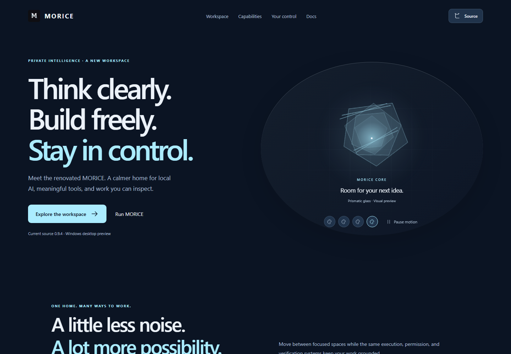
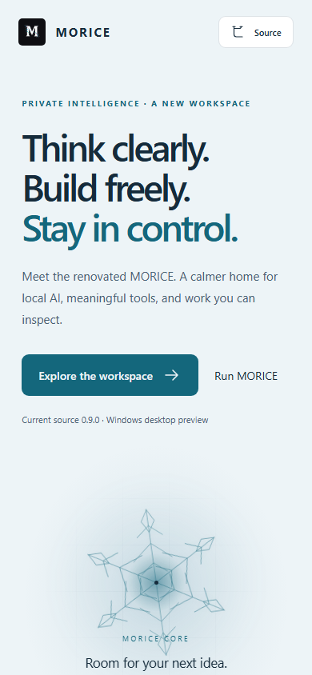

# MORICE website

The product overview is a React + TypeScript application built with Vite. The existing GitHub Pages workflow deploys `website/dist`. Current source is 0.9.0; published Windows/Android 0.8.0 downloads are explicitly labelled as earlier builds.

## Current production-build previews

| Glass on desktop | Ice on mobile |
| --- | --- |
|  |  |

These owned-browser captures show the local production build on October 15, 2026. The embedded desktop images come from the actual renovated native app in isolated profiles. They do not establish live deployment or infer model activity.

## Development

```bash
cd website
npm ci
npm run dev
```

Build and preview:

```bash
npm run typecheck
npm run build
npm run preview
```

Vite's local preview serves the build at its root. Relative asset paths also support the repository's `/MORICE/` GitHub Pages deployment.

## Architecture and interaction

`src/App.tsx` owns semantic sections, authored SVG pictograms, four scene presets, pause/resume, keyboard workspace tabs and truthful source/download links. Midnight uses an orbital star atlas; Ice blooms into a crystal; Solar rotates corona filaments; Glass floats refractive facets. The website Core is decorative and does not record audio, load a model or imply a live task.

`src/styles.css` defines theme variables, distinct closed animation cycles, focus states and responsive layouts. Animation endpoints return to the same pose. The website pauses decoration when hidden, exposes a visible motion control and honours the operating system's Reduced Motion setting. It uses system fonts and no icon pack.

`public/` holds the original MORICE logo and four current native workspace captures. The older `NeuralCanvas.tsx` and `useScrollProgress.ts` remain unimported historical source; the current page does not mount a scrolling cinematic canvas.

## Verification and deployment

The local production build was checked at 1440×1000 and 390×844: no horizontal overflow or broken loaded images, all four motifs present with changing transforms, pause/resume, arrow-key workspace switching and a fresh load with zero console errors/warnings. This is browser validation, not compositor or physical-device certification.

`.github/workflows/pages.yml` installs the locked dependencies, builds the site and deploys through the official GitHub Pages actions. Authorized publication is the final stage after the software candidate checks. A successful local build alone is not a live deployment result. See the [release audit](../docs/release-audit-report.md) for current scope and constraints.
